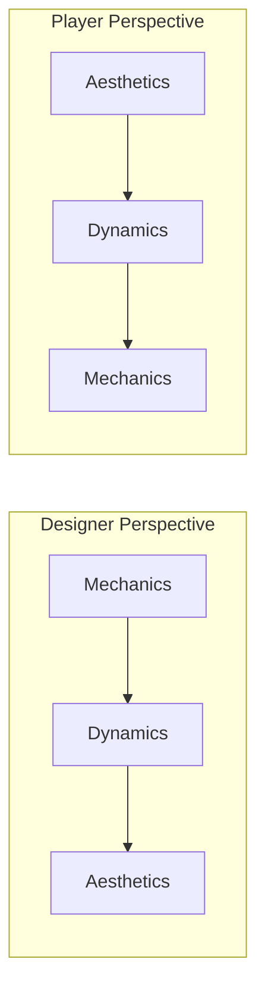
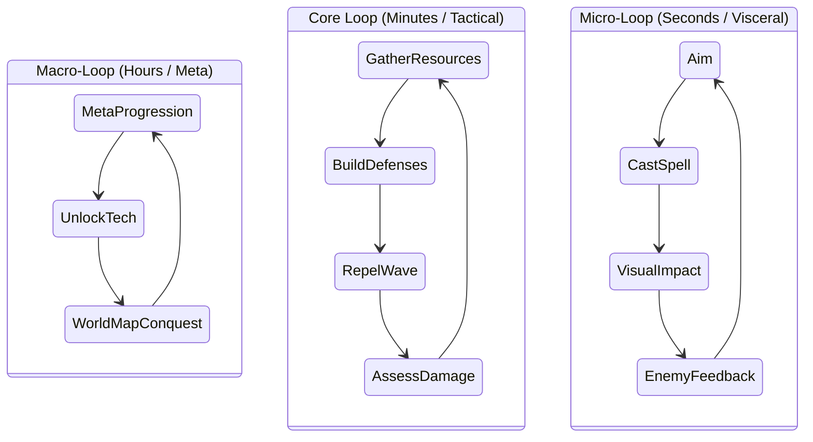
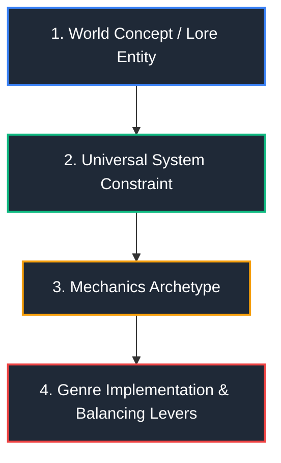

# 🎮 About Game Design: Philosophy, Frameworks & The World-First Pipeline

> *"A game is a series of interesting decisions made within a structured context."*  
> — Adapted from Sid Meier

Welcome to the foundational guide to **Game Design** within the **ETWorldDesigner** ecosystem. This document serves as the master philosophy, theoretical baseline, and practical architectural manual for turning ideas, mechanics, and world lore into cohesive, engaging player experiences.

---

## 🧭 1. The Core Philosophy: World-First Game Design

In traditional game development, game mechanics are often engineered in a vacuum. A team invents a jump mechanic or a gunplay loop, skins it with disposable placeholder fiction, and discards the world when the project wraps.

**In ETWorldDesigner, we reverse this process:**

```
               ┌────────────────────────────────────────┐
               │         🌍 WorldDesigner (Source)       │
               │  Cosmology • Geography • Races • Rules │
               └───────────────────┬────────────────────┘
                                   │
         ┌─────────────────────────┼─────────────────────────┐
         ▼                         ▼                         ▼
 🛡️ Town Defense             ⚔️ Continental RTS       🏹 Tactical Dungeon RPG
 (Micro: Outpost Survival)   (Macro: Grand Strategy)   (Meso: Squad Infiltration)
```

1. **The World is the Operating System**: Geography, physics, biology, magic systems, and geopolitical tensions are established in `WorldDesigner`. They provide the non-negotiable laws and constraints.
2. **Games are Genre Lenses**: A single world entity (e.g., an ancient crystalline leyline) manifests differently depending on the camera angle and genre lens:
   - In a **Town Defense** game, it is an unstable energy battery you must protect from swarms.
   - In an **RTS**, it is a high-yield contested resource node driving mid-game expansion.
   - In a **Tactical RPG**, it is an interactive terrain hazard granting elemental buffs or environmental spell combos.
   - In a **Mobile/Casual game** (e.g., [[Mobile game/Neko Seek]]), it could be a whimsical beacon where mystical creatures gather.
3. **Cohesive Meaning**: When mechanics reflect the lore and the lore justifies the mechanics, players experience profound immersion and intuitive clarity—eliminating ludonarrative dissonance.

---

## 🏛️ 2. Foundational Frameworks

### 2.1 The MDA Framework

Developed by Robin Hunicke, Marc LeBlanc, and Robert Zubek, the **MDA Framework** bridges the gap between game design and player experience:



| Component | Definition | ETWorldDesigner Example |
| :--- | :--- | :--- |
| **Mechanics** (Rules) | Algorithms, data structures, verbs, physics, input schemas, and state constraints. | Turret range = 12m; Fire rate = 1.5s; Frost damage inflicts -30% movement speed for 3s. |
| **Dynamics** (Run-time) | Emergent behavior arising when players execute mechanics in real time. | Players construct choke points that combine frost slow with splash damage to stall armored waves. |
| **Aesthetics** (Emotions) | The desirable emotional, psychological, and sensory responses evoked in the player. | High-stakes tension, relief upon wave clear, intellectual mastery of tactical placement. |

#### The 8 Core Aesthetics of Play
When pitching or designing any module in `GameDesigner`, identify the 2–3 primary aesthetics targeted:
1. **Sensation** (Game as sensory pleasure: audiovisual juice, crisp input responsiveness).
2. **Fantasy** (Game as make-believe: inhabiting an alien empire, commanding mythical races).
3. **Narrative** (Game as drama: conflict, pacing, tragic defeats, climactic comebacks).
4. **Challenge** (Game as obstacle course: mastery, skill expression, problem-solving).
5. **Fellowship** (Game as social framework: cooperation, rivalry, shared defense).
6. **Discovery** (Game as uncharted territory: map exploration, discovering synergies).
7. **Expression** (Game as soapbox: customization, base layouts, unique playstyles).
8. **Submission / Relaxation** (Game as pastime: meditative loops, idle progression, routine).

---

### 2.2 The Nested Game Loops

Every engaging game operates on nested chronological feedback loops:



* **Micro-Loop (Sub-second to 5 seconds)**: The kinesthetic feel ("Game Feel" / "Juice"). Aiming a target, firing a weapon, seeing damage numbers, hearing sound cues, feeling screen shake.
* **Core Loop (30 seconds to 10 minutes)**: The primary gameplay cycle. Collect resources $\to$ Build & Upgrade $\to$ Trigger Encounter $\to$ Evaluate Outcome $\to$ Reinvest.
* **Macro-Loop (Hours to Weeks)**: Campaign progression, global faction influence, persistent research trees, narrative milestones, and meta-unlocks.

---

### 2.3 Player Psychology & The Flow Channel

Based on Mihaly Csikszentmihalyi's Flow Theory, players remain in an optimal state of engagement when the game balances **Perceived Challenge** with **Player Skill**:

```
Challenge ▲
          │         ANXIETY / FRUSTRATION
          │          (Difficulty too high)
          │            /
          │           /   FLOW CHANNEL
          │          /  (Optimal Engagement)
          │         /
          │        /
          │       /   BOREDOM / APATHY
          │      /  (Skill outpaces challenge)
          └─────────────────────────────► Skill
```

#### Achieving Dynamic Balance:
* **Tension and Release Pacing**: Never maintain maximum stress continuously. After an intense climax (e.g., a boss wave in Town Defense), provide a lull for planning, upgrading, and breathing.
* **Heuristic Learning**: Introduce new mechanics in safety, test them in moderate isolation, and only then combine them with prior mechanics under pressure.
* **Self-Selected Difficulty**: Allow players to take calculated risks (e.g., triggering optional monster dens for higher bounty vs. turtle-building safely).

---

## ⚙️ 3. The Anatomy of Game Systems

### 3.1 Player Verbs & Action Space
A game design document must define what the player *actually does*:
* **Primary Verbs**: Actions performed every few seconds (e.g., *Move, Aim, Construct, Attack, Harvest*).
* **Secondary Verbs**: Actions performed periodically to alter tactical context (e.g., *Upgrade, Rally, Trade, Fortify, Specialize*).
* **Tertiary Verbs**: Meta-level actions (e.g., *Diplomacy, Technology Respec, Faction Alignment*).

> [!TIP]
> **Rule of Economy in Verbs**: Depth does not come from having 100 verbs. Depth comes from having 4–6 robust, expressive verbs that interact dynamically with the game environment in 100 different ways.

---

### 3.2 Feedback Loops: Positive vs. Negative

```
┌──────────────────────────────────────┐     ┌──────────────────────────────────────┐
│       Positive Feedback Loop         │     │       Negative Feedback Loop         │
│         (Amplifies Drift)            │     │        (Stabilizes System)           │
├──────────────────────────────────────┤     ├──────────────────────────────────────┤
│ Example: Winning battles awards gold │     │ Example: Expanding territory raises │
│ which buys stronger units, leading to│     │ upkeep costs, slowing expansion and  │
│ even easier victories (Snowballing). │     │ giving trailing players room to rally│
│ • Pros: Clear victory condition.     │     │ • Pros: Keeps matches competitive.   │
│ • Cons: Runaway leader problem.      │     │ • Cons: Can feel like punishment.    │
└──────────────────────────────────────┘     └──────────────────────────────────────┘
```

A master game designer balances both:
* Use **Positive Loops** to drive matches or runs to a decisive, satisfying conclusion.
* Use **Negative Loops** (Rubber-banding, catch-up bounties, supply lines, upkeep) to prevent early failure cascades and keep players engaged until the final third of a match.

---

### 3.3 Game Feel ("Juice")
The difference between a sterile simulation and an addictive game is sensory communication:
* **Input Buffering & Coyote Time**: Forgiving player input timing to guarantee intentionality.
* **Hit-Stop & Anticipation**: Freezing animations for 2–4 frames during high-impact strikes to convey mass.
* **Audio Staging**: Dynamic mixing where low-health heartbeat sounds duck ambient tracks, highlighting danger.
* **Camera Polish**: Subtle screenshake with directional falloff, focal zooms on critical moments.

---

## 🌉 4. The ETWorldDesigner Translation Pipeline

When designing any mechanic or system, follow this translation matrix from `WorldDesigner` down to `GameDesigner`:



### Translation Matrix Example

| Step | Design Level | Case Study: The "Resonance Shard" |
| :--- | :--- | :--- |
| **1. World Lore** | `WorldDesigner/Geography` | A dense, brittle mineral harvested from sub-crustal fault lines that vibrates at harmonic frequencies. |
| **2. Universal Rule** | `WorldDesigner/Systems` | Emits continuous concussive waves when struck; destabilizes electrical and arcane conduits; easily shattered by physical impact. |
| **3. Mechanics Archetype** | `GameDesigner/SharedAssets` | Area-of-Effect (AoE) Disruption Hazard / High-Risk High-Reward Resource Node. |
| **4A. Town Defense Lens** | `GameDesigner/TownDefense` | **Sonic Pylon**: Built near choke points. Pulses shockwaves that stagger incoming light swarms, but damages adjacent player stone walls if overloaded. |
| **4B. RTS Lens** | `GameDesigner/RTS` | **Harmonic Disruptor Tank**: Siege unit that disables enemy power grids and defensive turrets in an area, but has minimal HP and requires escort. |
| **4C. Tactical RPG Lens** | `GameDesigner/RPG_Tactics` | **Fault Crystal Trap**: Destructible combat prop. Striking it with blunt damage triggers a deafening cone stun affecting both heroes and monsters. |

---

## 📋 5. Game Design Document (GDD) Template for This Vault

When authoring new game projects in `GameDesigner/`, use the following standardized structure:

### GDD Outline
1. **Executive Summary / Elevator Pitch**
   - 1–2 sentence high concept.
   - Core aesthetic target (e.g., *Challenge + Discovery*).
   - Target platform & controls (PC, Mobile, Console, Touch/Mouse/Gamepad).
2. **The World Hook**
   - Links to `WorldDesigner` documents (Era, Continent, Factions involved).
   - What specific conflict or situation is being simulated?
3. **Core Loop Diagram**
   - Visual Mermaid loop showing micro, core, and macro progression.
4. **Player Verbs & Mechanics Specification**
   - Complete breakdown of inputs, actions, states, and cooldowns.
5. **System Interactions & Economy**
   - Resource inflow (Faucets), outflow (Sinks), and conversion rates.
   - Balance levers (HP, DPS, Build Times, Movement Speeds).
6. **Game Feel & Sensory Direction**
   - Camera behavior, UI responsiveness, sound landscape, visual feedback rules.
7. **Production & Milestones**
   - Core Prototype (Greybox proof of loop) $\to$ Vertical Slice $\to$ Full Systems Integration.

---

## 🚫 6. Common Design Anti-Patterns to Avoid

* ❌ **The "Kitchen Sink" Trap**: Adding features just because other games have them. Every mechanic must serve the core pillars.
* ❌ **Dominant Strategies ("No-Brainer" choices)**: If one unit, build order, or ability is always the mathematically superior choice, player choice becomes an illusion.
* ❌ **Ludonarrative Contradiction**: Making a peaceful scholarly faction play identically to bloodthirsty berserkers with just a different paint job.
* ❌ **Information Obscurity**: Hiding essential tactical information from the player under the guise of "mystery" or poor UI. Rules must be transparent; outcomes must be readable.
* ❌ **Execution over Vision**: Building prototype code before establishing what emotional dynamic or core loop makes the game uniquely compelling.

---

## 🔗 7. Navigation & Related Links

* 🏠 Root README: [[README]]
* 🌍 World Hub: `WorldDesigner/`
  * [[Cosmology]] — Star systems, planetary physics & celestial rules
  * [[Geography]] — Continents, regions & tactical terrain
  * [[Races & Factions]] — Species, political powers & civilizations
  * [[Systems]] — Magic laws, energy flow & technological limits
* 🎮 Game Projects: `GameDesigner/`
  * [[TownDefense]] — Outpost frontier siege & colony survival
  * [[RTS]] — Grand continental warfare & macro-economies
  * [[RPG_Tactics]] — Character progression & dungeon crawls
  * [[Mobile game/Neko Seek]] — Casual seek-and-find prototype
  * [[PC Game/Forever Alone About]] — Psychological horror & reality-swap adventure
