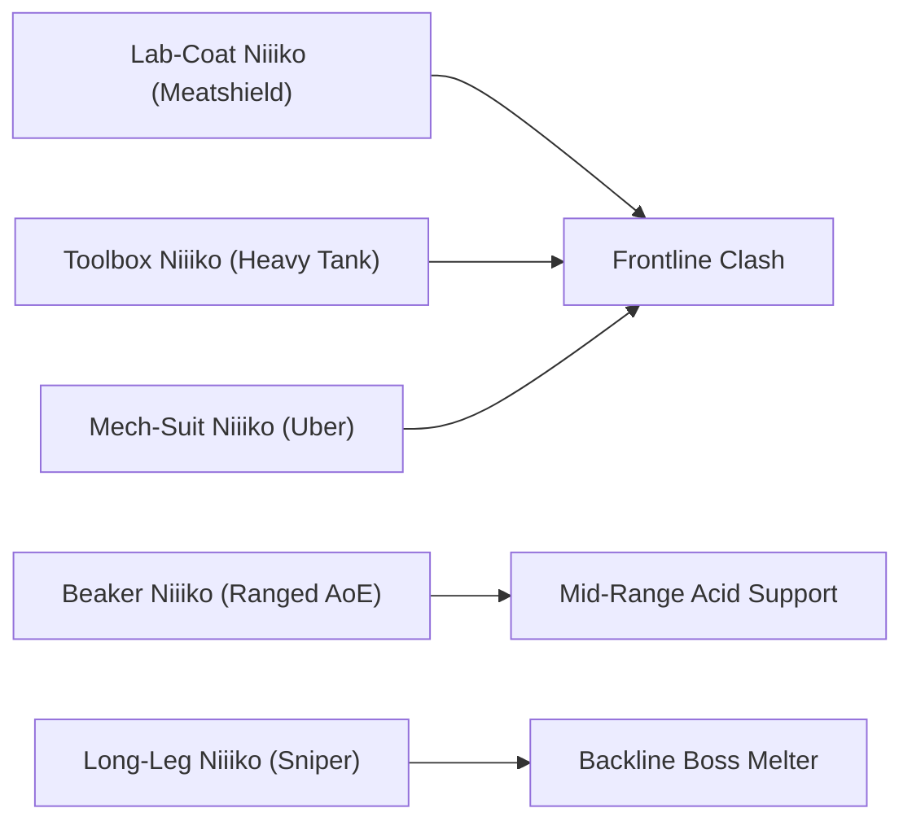

# Niiiko vs Human: Cat Girl Defense (Working Title)

| Command an army of quirky lab-coat cat-girls to establish sovereign Niiiko rule across the globe!
| Product Vision, Modular Lane Combat Architecture & Hybrid-Casual Monetization GDD
| ET STUDIO / 2026

---

## Game Concept

| Concept                  | Value                                                                                                                                                                                                                                                                                                                                                                                                                                                                                                                                                                                                                                                                                                                                                                                                                                                                                      |
| :----------------------- | :----------------------------------------------------------------------------------------------------------------------------------------------------------------------------------------------------------------------------------------------------------------------------------------------------------------------------------------------------------------------------------------------------------------------------------------------------------------------------------------------------------------------------------------------------------------------------------------------------------------------------------------------------------------------------------------------------------------------------------------------------------------------------------------------------------------------------------------------------------------------------------------- |
| **Title**                | **Niiiko vs Human: Cat Girl Defense**                                                                                                                                                                                                                                                                                                                                                                                                                                                                                                                                                                                                                                                                                                                                                                                                                                                       |
| **Subtitle**             | 2D Side-Scrolling Cat-Girl Tower Defense & Lane Battler                                                                                                                                                                                                                                                                                                                                                                                                                                                                                                                                                                                                                                                                                                                                                                                                                                    |
| **Description**          | **Niiiko vs Human: Cat Girl Defense** is a fast-paced, comedic 2D side-scrolling lane defense mobile game where players command an army of quirky, lab-coat-wearing cat-girls (Niiikos) on a crusade to liberate Earth from greedy, inefficient, and ridiculous human rule. From clandestine underground research laboratories, the Niiikos march across Earth's major cultural metropolitan hubs—deploying scientific slapstick combat against frantic street swarms, greasy corporate suits, and goofy municipal bosses. Featuring a high-tension dynamic knockback tug-of-war system, manual emergency super-weapon particle blasts, chapter-based continental relic progression, deep unit leveling, and a high-LTV hybrid monetization framework (Rewarded Ads + Interstitials + IAP Starter Bundles), the game is engineered for low install friction and long-term global retention. |
| **Genre**                | 2D Side-Scrolling Tower Defense / Lane Battler / Casual Strategy                                                                                                                                                                                                                                                                                                                                                                                                                                                                                                                                                                                                                                                                                                                                                                                                                           |
| **Theme**                | Anime cat-girl sci-fi parody, slapstick comedy, whimsical laboratory science vs. ridiculous human caricatures                                                                                                                                                                                                                                                                                                                                                                                                                                                                                                                                                                                                                                                                                                                                                                               |
| **Setting**              | Major Earth metropolitan hubs and cultural centers (Chapter 1 MVP: Southeast Asia — Vietnam old town alleyways, Thailand neon night markets, Singapore futuristic high-rise CBD) and clandestine Niiiko mobile research labs                                                                                                                                                                                                                                                                                                                                                                                                                                                                                                                                                                                                                                                              |
| **Player Role**          | The Niiiko Field Commander / Supreme Lab Overseer, directing real-time resource allocation, troop summoning order, and tactical Particle Blaster orbital strikes                                                                                                                                                                                                                                                                                                                                                                                                                                                                                                                                                                                                                                                                                                                             |
| **Core Gameplay**        | Upgrade the in-match Catnip Cash production gauge in real time, deploy Niiiko combatants onto a single horizontal lane to clash with advancing human waves, execute knockback breathing-room triggers, and discharge the Base Particle Blaster to obliterate opposing human strongholds                                                                                                                                                                                                                                                                                                                                                                                                                                                                                                                                                                                                   |
| **Objective**            | March across the battlefield, overwhelm incoming human waves, push back boss units, and reduce the human city outpost's HP to 0 while defending the Niiiko Research Lab on the left edge of the screen                                                                                                                                                                                                                                                                                                                                                                                                                                                                                                                                                                                                                                                                                     |
| **Progression**          | Clear Chapter 1 (15 stages across Vietnam, Thailand, and Singapore), unlock permanent regional Relic buffs, level up unit base stats (HP/ATK) and lab infrastructure (Base HP, Cannon Recharge) using Fish Treats/Coins, collect rare units via the Lucky Lab Capsule Gacha, and advance toward global domination                                                                                                                                                                                                                                                                                                                                                                                                                                                                                                                                                                         |
| **Unique Selling Point** | 1. **Dynamic Burst Knockback Physics**: Burst-damage thresholds force units backward into visual cartoon tumbles, turning lane battles into an elastic, nail-biting tug-of-war rather than static hitpoint attrition.<br>2. **Weaponized Cat-Girl Science vs. Degenerate Humans**: Hilarious weaponized lab gear (acid beakers, wrench whacks, laser pointers, piston mechas) colliding with parody human stereotypes (awkward disco-dancing uncles, smile-scamming influencers, net trappers).<br>3. **Original Ergonomic IP-Safe Mobile HUD**: Circular laboratory gauge for money leveling, curved bottom-right thumb deployment grid, and lower-left interactive syringe dial for cannon firing, delivering smooth one-handed mobile play with zero copyright friction.                                                                                                            |
| **Art Style**            | 2D clean cell-shaded/vector cartoon anime aesthetic with expressive, hand-drawn sprite animations, thick cell outlines, exaggerated squash-and-stretch slapstick, and zero blood or graphic violence                                                                                                                                                                                                                                                                                                                                                                                                                                                                                                                                                                                                                                                                                          |
| **Audio (BGM/SFX)**      | Upbeat electro-swing marching brass and playful anime pop BGM; comical cartoon SFX (squeaky wrench thwacks, bubbling acid fizz, laser pointer buzzes, disco synth stings, and funny cartoon "poof" defeat noises)                                                                                                                                                                                                                                                                                                                                                                                                                                                                                                                                                                                                                                                                            |
| **Target Audience**      | Mobile casual gamers, anime/cat-girl enthusiasts, fans of *The Battle Cats*, *Cartoon Wars*, and humorous lane defense titles (All genders, ages 12–35)                                                                                                                                                                                                                                                                                                                                                                                                                                                                                                                                                                                                                                                                                                                                     |
| **Platform**             | Mobile: Android primary (Google Play), iOS secondary (App Store) — Landscape orientation (`16:9` / `19.5:9` wide lane display)                                                                                                                                                                                                                                                                                                                                                                                                                                                                                                                                                                                                                                                                                                                                                              |

---

## References

- **UI / UX Flow (Figma):** `TBD — Landscape 16:9 Mobile Flow (Title / World Map -> Deck Setup -> Battle Screen [Lab on Left / City on Right] -> Victory / Defeat Popup -> Lab Research Upgrade)`
- **Game Data Sheet:** [`link`](https://docs.google.com/spreadsheets/d/1ks_tdjPYvBlGu7S6V8U2rc7-jrp7gqmgjHkIacJmhYc/edit?usp=sharing) (Unit combat stats, enemy spawn pacing, and relic formulas)
- **Visual / Market References:**
  - *The Battle Cats* (PONOS) — Master reference for lane deployment rhythm, worker level-up mechanics, base cannon screen wipe, and global conquest progression.
  - *Line Rangers* / *Cartoon Wars* — Accessible mobile unit summoning, charming comedic unit animations, and character-driven gacha progression.
  - *Niiikotopia: Human* (ET Studio Universe) — demi-human Niiiko universe, lab-coat visual motifs, and playful human-versus-cat-girl lore adapted into an accessible, lighthearted casual mobile spin-off.

---

## Game cycle

Each stage in **Niiiko vs Human: Cat Girl Defense** delivers a thrilling, accessible **60-to-120 second tactical battle cycle** designed for high session velocity, bite-sized mobile play, and natural ad-monetization touchpoints.

```
[World Map / Stage Selection]
           │ (Spends 10 Lab Energy)
           ▼
[Lane Battle: Manage Catnip Cash & Spawn Niiiko Units] ──► [Deploy Niiiko Particle Blaster]
           │
           ▼
     [Victory / Defeat]
           │
     ┌─────┴────────────────────────────────┐
     ▼                                      ▼
[Victory: Earn Fish Treats & Relics]   [Defeat: Watch Ad Revive / Free Retry]
     │                                      │
     ▼                                      ▼
[Upgrade Niiiko Roster & Base Cannon]  [Adjust Deck Composition / Level Up Units]
     │
     ▼
[Unlock Next Global Region & Relic Buff]
```

- **Step 1 (Preparation / Input — Deck Check & Stage Launch):**
  - The player selects a stage on the World Map (spends `10 Lab Battery` energy).
  - The player reviews their active 5-to-10 unit deployment deck, equips any collected Continental Relics, and taps **"To Battle!"**.
  - The match initializes with the player's **Niiiko Mobile Lab** on the far left (`100% HP`) and the **Human City Outpost** on the far right (`100% HP`).
- **Step 2 (Active Phase — Resource Management & Lane Battle):**
  - **Resource Generation:** Catnip Cash accumulates continuously based on the current Production Level (starts at Level 1).
  - **Worker Leveling:** Players decide whether to tap the top-left Laboratory Gauge to upgrade the Cash generation speed and maximum storage cap (Levels 1–8) or immediately spend funds to summon troops.
  - **Unit Summoning:** Tapping available unit cards in the bottom-right deck spends Catnip Cash and puts the unit on cooldown. The summoned Niiiko spawns and automatically marches rightward.
  - **Dynamic Combat & Knockback:** Upon reaching attack range of an opposing human or outpost, units automatically initiate combat according to attack speed and reach. Dealing threshold burst damage triggers dynamic knockback, tumbling units backward and opening frontline space.
  - **Super Weapon Activation:** When human swarms threaten the lab or a boss winds up a lethal slam, the player taps the lower-left Syringe Dial to fire the **Niiiko Particle Blaster**, sweeping the screen with heavy AoE damage and multi-knockback.
- **Step 3 (Completion / Climax):**
  - **Win Trigger:** The human city outpost's HP is reduced to `0`. Human forces flee with comical sweat drops and cartoon dust clouds. A cheerful victory screen displays stage completion time, Fish Treats earned, and any newly discovered Regional Relics.
  - **Fail Trigger:** The Niiiko Mobile Lab's HP is reduced to `0`. Frontline cat-girls retreat in tears. The defeat screen offers an **Emergency Ad Revive** (restores lab to `50% HP` and wipes active lane enemies) or a direct retry.
- **Result:**
  - Clearing a stage grants **Fish Treats (Soft Currency)**, **Commander XP**, **Chapter Relic Progress**, and unlocks the next contiguous stage along the global conquest route.

**Key Aspects of Every Cycle:**
- **Progress Tracking:** Visible in real-time via the **Human Outpost HP Bar** (top-right), the **Camera Minimap / Distance Tracker** across the lane, and the **Particle Blaster Charge Dial** (lower-left).
- **Base Duration of a Single Cycle:** `45–90 seconds` on standard stages; `90–150 seconds` on milestone Chapter Boss stages.
- **Cycle Time Scaling Rules:**
  - **Stages 1–5 (Vietnam):** `45–60 seconds` average clear time (fast onboarding, swarms of low-HP rushers).
  - **Stages 6–10 (Thailand):** `60–90 seconds` average clear time (introduction of tanks and crowd-control trickers).
  - **Stages 11–15 (Singapore):** `90–120 seconds` average clear time (advanced high-tech shields, heavy mini-bosses, and the City Commissioner Boss).
- **Ways to Reduce or Speed Up Cycle Time:**
  - **2x Battle Speed Toggle:** Unlocked after clearing Stage 3; accelerates in-match physics and timers by `200%`.
  - **Niiiko Particle Blaster:** Instantly vaporizes low-tier swarms and clears the lane for fast base siege.
  - **Pre-Battle Power-Ups (Coins / Rewarded Ad):**
    - *Catnip Overdrive:* Match starts at Production Level 3 with `+200 Initial Cash`.
    - *Sniper Niiiko Drone:* An automated orbiting drone assists from off-screen, sniping distant enemies every `8 seconds`.
- **How Player Choices Affect the Cycle Outcome:**
  - Over-investing in high-tier units (e.g., Mech-Suit Niiiko) early leaves the lab undefended against fast Trench-Coat Dashers; spamming only cheap Lab-Coat meatshields creates a stalemate against Greasy Uncle tanks unless backed by Beaker Niiiko AoE or Long-Leg snipers.

---

## Game reward

Completing battles rewards players with immediate resources to upgrade their army and expand their scientific lab infrastructure.

- **Base Cycle Reward:**
  - **Fish Treats (Coins):** `150–600 Fish Treats` based on stage tier (`+100%` bonus on first-time clear).
  - **Commander XP:** `50–200 XP` toward Commander Level (grants maximum Lab Battery energy expansions).
  - **Lab Battery Refill:** Fast automatic recharge (`1 Energy` recovered every `2.5 minutes`, cap `100`).
- **Variable / Drop Reward:**
  - **Regional Relic Drops:** Each region has a `15%–25%` drop chance per clear until the relic is acquired:
    - *Vietnam:* **Drip Coffee Relic** (+10% Unit Movement Speed).
    - *Thailand:* **Golden Spices Relic** (+10% In-Battle Cash Generation Speed).
    - *Singapore:* **Transit Card Relic** (-8% Deployment Cost for all units).
  - **Lucky Gacha Capsule Tickets:** Awarded on all milestone boss stages (every 5th stage).
- **Final Reward Formula:**
  $$\text{Final Fish Treats} = (\text{Base Stage Treats} + \text{Clear Speed Bonus}) \times \text{Ad Multiplier} \times \text{Relic Multiplier}$$
  - Where $\text{Clear Speed Bonus} = \max\left(0, \lfloor (120 - \text{ClearTimeSec}) \times 2.5 \rfloor\right)$.
- **Reward Modified by Ad:**
  - **Double Rewards Offer (Victory Screen):** Watching 1 Rewarded Ad multiplies Fish Treats earned by **`2x`** and doubles any dropped Relic fragment count.
- **Reward Modified by Mechanics:**
  - **Relic Synergy:** Unlocking all 3 Regional Relics in Chapter 1 activates the **Continental Master Buff**, providing an additional permanent `+15% Fish Treats` across all game modes.

---

## Core gameplay

**Niiiko vs Human: Cat Girl Defense** is built on a tight, strategic 2D lane-battler system where timing, deck synergy, and resource optimization dictate victory.

### (1) In-Battle Economy & Worker Production Gauge
Catnip Cash is the lifeblood of match tactics. It powers both troop deployment and laboratory production upgrades.

- **Mechanic Overview:**
  - Cash automatically accumulates in real time at a rate determined by the player's in-match **Worker Level (Lv 1 to Lv 8)**.
  - The worker upgrade button is integrated into the top-left **Circular Laboratory Gauge**. Tapping it spends the indicated amount of Catnip Cash to increase both the generation rate ($R$) and maximum cash capacity ($C_{\max}$).
- **Worker Level Scaling Table:**

| Worker Level | Upgrade Cost (Cash) | Cash Tick Rate (per sec) | Max Cash Storage | Strategic Role |
| :--- | :--- | :--- | :--- | :--- |
| **Level 1** | Base (0) | `15 Cash/s` | `100 Cash` | Opening swarm defense / meatshield deployment |
| **Level 2** | `60 Cash` | `24 Cash/s` | `200 Cash` | Establish frontline stability; deploy Toolbox Niiiko |
| **Level 3** | `120 Cash` | `36 Cash/s` | `350 Cash` | Transition to ranged AoE Beaker Niiiko support |
| **Level 4** | `200 Cash` | `52 Cash/s` | `550 Cash` | Save up for Long-Leg Niiiko sniper deployment |
| **Level 5** | `320 Cash` | `72 Cash/s` | `800 Cash` | Mid-battle pressure against enemy tanks |
| **Level 6** | `480 Cash` | `96 Cash/s` | `1,100 Cash` | Economy threshold required to summon Mech-Suit Niiiko |
| **Level 7** | `680 Cash` | `125 Cash/s` | `1,500 Cash` | Endgame lane flood & aggressive boss siege |
| **Level 8 (MAX)** | `950 Cash` | `165 Cash/s` | `2,000 Cash` | Maximum swarm spamming; overwhelm base defenses |

- **Design Purpose:** Forces dynamic tactical trade-offs: upgrading the worker early accelerates late-game power but leaves the lane open to early rusher blitzes; neglecting upgrades stalls production and starves high-tier units.

### (2) Tactical Lane Summoning, Unit Roles & Dynamic Knockback
The single horizontal lane functions as a tug-of-war battleground where positioning, range, and burst damage determine line stability.

| Occurrence | Trigger Timing | Role | Effect |
| :--- | :--- | :--- | :--- |
| **Frontline Stall** | Early game (`0–20s`) | Stall fast rusher units | Cheap Lab-Coat Niiikos absorb hits and hold line position |
| **Damage Threshold Knockback** | Burst damage reaches $\ge \text{Knockback Limit}$ | Defensive breathing room & lane reset | Unit plays a tumbling cartoon animation, slides back `80px`, and cancels current attack windup |
| **Counter-Attack Push** | Heavy tank / sniper deployment (`40–80s`) | Clear swarms and push enemy back | High-damage AoE units melt frontline enemies and advance toward enemy base |
| **Emergency Screen Wipe** | Enemy swarms reach within `150px` of player lab | Prevent catastrophic defeat | Particle Blaster fires, clearing all non-boss units and resetting line |

- **Knockback Formula:**
  $$\text{Damage for Knockback} = \frac{\text{Unit Max HP}}{\text{Knockback Count}}$$
  - Example: A Greasy Uncle with `3,000 HP` and `3 Knockbacks` tumbles backward every time he absorbs `1,000 damage`. Clever timing of high-burst attacks knocks him back repeatedly before he can hit the frontline.
- **Example Gameplay Case:**
  - **Stage 8 (Thailand Night Market):** Two *Trench-Coat Dashers* rush early. The player deploys two *Lab-Coat Niiikos* (`50 Cash` each) to block them, while upgrading Worker to Level 2.
  - A *Greasy Uncle* enters doing his flailing disco shuffle. His contact damage starts mowing through Lab-Coat meatshields.
  - The player upgrades to Worker Level 3 and deploys *Beaker Niiiko* (`220 Cash`). Bubbling acid splashes melt the surrounding swarms.
  - The player saves for *Long-Leg Niiiko* (`450 Cash`), whose laser bursts hit the Greasy Uncle for `1,100 damage`, instantly triggering a cartoon knockback stumble, halting his advance and securing the lane.

### (3) Base Super Weapon: Niiiko Particle Blaster
Mounted upon the Niiiko Mobile Lab, the Particle Blaster is an experimental super-science directed-energy cannon designed for clutch defensive reversals.

| Name | Category | Description |
| :--- | :--- | :--- |
| **Standard Particle Beam** | Active Base Skill | Fires a sweeping turquoise energy laser across the entire battlefield, dealing heavy AoE damage and applying a guaranteed knockback to all ground enemies. |
| **Cryo-Stabilizer Shot** | Laboratory Upgrade Skill | Adds a `2.5-second` freeze/slow debuff to all surviving human enemies hit by the beam. |
| **Overdrive Ad Recharge** | Emergency In-Battle Offer | When base HP drops below `30%`, watching 1 Rewarded Ad grants an instant `100%` Cannon recharge and temporary invulnerability shield for `5 seconds`. |

**UI & Cost Formula (Cannon Upgrade System):**
- **UI Name:** **Particle Blaster Lab Panel** (inside Laboratory Meta Screen).
- **Rules & Constraints:** Requires Fish Treats to level up; base cooldown starts at `60.0 seconds` and reduces with lab upgrades.

| ID | Upgrade Name | Base Value | Cost Formula | Effect per Level |
| :--- | :--- | :--- | :--- | :--- |
| **C1** | **Cannon Power** | `500 Damage` | $\text{Cost} = 200 \times (\text{Level})^{1.45}$ | `+150 Damage` per level |
| **C2** | **Recharge Accelerator** | `60.0s Cooldown` | $\text{Cost} = 300 \times (\text{Level})^{1.50}$ | `-1.5s Cooldown` (capped at `30.0s`) |
| **C3** | **Knockback Impulse** | `80px Distance` | $\text{Cost} = 250 \times (\text{Level})^{1.40}$ | `+10px Knockback` distance |

- **Cannon Firing Formula:**
  $$\text{Damage}_{\text{Cannon}} = \text{BaseCannonDamage} \times \left(1 + 0.2 \times (\text{Level}_{\text{Cannon}} - 1)\right) \times \text{RelicBonus}$$

### (4) World Map & Chapter Progression (Southeast Asia MVP: Vietnam, Thailand, Singapore)
Progression unfolds across real-world global regions where players topple local human authorities to establish sovereign Niiiko research branches.

| Region | Stages | Environment & Thematic Gimmick | Completion Relic Reward |
| :--- | :--- | :--- | :--- |
| **Vietnam** | Stages 1–5 | Old town alleyways, motorcycle rushers, street-cart barricades. Fast-paced swarm encounters. | **Drip Coffee:** `+10%` Movement Speed across all active Niiiko units. |
| **Thailand** | Stages 6–10 | Vibrant night markets, neon tuk-tuks, street food shielders. Introduces debuffers and heavy dancers. | **Golden Spices:** `+10%` In-Battle Cash Generation Rate. |
| **Singapore** | Stages 11–15 | Futuristic high-rise CBD, security drones, high-tech boss barricades. High-armor corporate enemies. | **Transit Card:** `-8%` Deployment Cost on all Niiiko units. |

- **Regional Relic Synergy:**
  - Collecting all 3 Relics in Chapter 1 unlocks the **Southeast Asia Grand Sovereign Trophy**, providing an account-wide `+15% Fish Treats` bonus and granting the exclusive **UR Scientist Niiiko Skin**.

### (5) Collection of creatures / items
The **Niiiko Research Codex** catalogs all discovered cat-girl combatants and defeated human enemy types.

- **Roster Collection:**
  - **Niiiko Army Units (15 Total at MVP):** Spanning 5 roles (Meatshield, Tank, Ranged AoE, Sniper, Boss Finisher) across 5 rarity tiers.
  - **Human Enemy Bestiary (15 Total at MVP):** Profiles detailing enemy attack patterns, weaknesses, comical lore descriptions, and defeat animations.
- **Collection Milestone Rewards:**
  - **40% Codex Completion:** `+1,000 Fish Treats` + `2 Lab Battery Refills`.
  - **80% Codex Completion:** `+3,000 Fish Treats` + `3 Lucky Gacha Tickets`.
  - **100% Codex Completion:** Exclusive **SSR Golden Lab-Coat Niiiko** + permanent `+10% Base HP` to the Mobile Lab.

### (6) Gacha (option)
The **Lucky Lab Capsule Machine** allows players to spend Niiiko Gems or Gacha Tickets to recruit rare cat-girl scientists and experimental unit variants.

- **Gacha Cost:**
  - **Single Pull:** `150 Niiiko Gems` OR `1 Lucky Gacha Ticket` OR **1 Daily Free Ad Pull** (cooldown: 24h).
  - **10x Pull Bundle:** `1,350 Niiiko Gems` (10% discount, guarantees at least 1 SR or higher).
- **Rarity Drop Rates:**
  - **Normal (N):** `50.0%`
  - **Rare (R):** `32.0%`
  - **Super Rare (SR):** `12.5%`
  - **Super Super Rare (SSR):** `4.5%`
  - **Ultra Rare (UR):** `1.0%`
- **Pity & Duplicate System:**
  - Every pull awards `+10 Pity Points`. At `100 Points (10 pulls)`, the next pull is guaranteed an **SR or higher**. At `300 Points (30 pulls)`, the player receives a guaranteed **SSR or UR Unit Capsule**.
  - Duplicate units are converted into **Unit DNA Shards**, used to unlock passive skill nodes and stat stars.

### (7) Daily Rewards (option)
A 7-day login calendar designed to drive Day-1 to Day-7 retention, accessible via the main menu and automatically triggered on first daily launch.

| Day | Reward Type | Amount |
| :--- | :--- | :--- |
| **Day 1** | Fish Treats | `500 Fish Treats` |
| **Day 2** | Niiiko Gems | `100 Niiiko Gems` |
| **Day 3** | Rare Unit Capsule | **Beaker Niiiko (Rare)** |
| **Day 4** | Fish Treats | `1,500 Fish Treats` |
| **Day 5** | Lab Battery Packs | `3 Full Energy Recharges` |
| **Day 6** | Niiiko Gems | `250 Niiiko Gems` |
| **Day 7** | Exclusive SSR Unit | **Cyber-Niiiko (SSR)** (or `1,000 Gems` if owned) |

- **Buttons:**
  - **Claim (1x):** Collects standard day reward.
  - **Double with Ad (2x):** Watching 1 Rewarded Ad doubles currency/pack quantities.
  - **Catch-Up Day:** Missing a day allows catching up by watching 1 Rewarded Ad.
- **Mechanisms:**
  - Resets at `00:00` local device time. After Day 7 is claimed, the calendar loops into a recurring Weekly Science Grant.

### (8) Daily Missions (option)
Daily missions focus on reinforcing core combat participation and voluntary ad monetization.

| ID | Mission name | Reward | Required |
| :--- | :--- | :--- | :--- |
| **1** | **Field Research** | `300 Fish Treats` | Clear `3` battles in any region |
| **2** | **Mass Mobilization** | `300 Fish Treats` | Deploy `30` Niiiko units total |
| **3** | **Particle Discharge** | `50 Niiiko Gems` | Fire the Niiiko Particle Blaster `2` times |
| **4** | **Human Countermeasure** | `400 Fish Treats` | Defeat `10` Greasy Uncle or Heavy human units |
| **5** | **Lab Sponsor** | `50 Gems` + `1 Battery Pack` | Watch `2` Rewarded Ads (Double Reward, Energy, or Gacha) |
| **6** | **Daily All-Clear Bonus** | `1 Lucky Gacha Ticket` | Complete all `5` Daily Missions today |

### (9) IAP Shop (option)
An integrated storefront offering convenience packages, premium currencies, and cosmetic customization.

- **Store Architecture:** Divided into 4 clear tabs: *Special Bundles*, *Gems Bank*, *Laboratory Supplies (Stamina/Boosters)*, and *Costumes*.
- **Store Expansion:** Native integration with Google Play Billing and Apple StoreKit with receipt validation.

### (10) Rating UI (option)
- **Trigger Timing:** Prompts the player after high-dopamine milestone moments:
  1. Immediately following victory on **Stage 10 (Thailand Final Stage)**.
  2. Immediately upon pulling a first **SSR or UR Cat-Girl** from the Gacha.
- **Frequency & Cooldown:** Appears at most once every 14 days; suppressed permanently if the user submits a rating.
- **UI Flow:** Cute pre-prompt featuring Lab-Coat Niiiko asking: *"Are you enjoying the Cat-Girl scientific revolution?"*
  - If *"Yes, Love it!"* (`5 Stars`) $\rightarrow$ Redirects to native Google Play / App Store review dialog.
  - If *"Needs Improvement"* $\rightarrow$ Opens in-game feedback form to capture complaints privately.

### (11) FAQ
- **Access Point:** Located inside the **Settings Menu** via the *"Lab Handbook & Support"* icon.
- **Display Method:** Native scrollable accordion popup list with fast in-memory display (no webview dependency).
- **Question Categories:**
  - *Gameplay Mechanics:* How does knockback work? What do Regional Relics do?
  - *Account & Energy:* How does Lab Battery recharge? How to restore purchases?
  - *Troubleshooting:* What to do if an ad fails to load or energy is desynced?
- **Contact Support Link:** Dedicated *"Contact Head Researcher"* button generating a pre-filled support email with User ID, device OS, and app version.

### (12) Tutorial
- **Trigger Condition:** Automatically activates upon the first app launch (`FirstTimeUser == true`).
- **Tutorial Type:** Lightweight, non-intrusive interactive onboarding across Stages 1–3.
- **Step-by-Step Flow:**
  - **Stage 1 (Vietnam Alley):** Guided finger highlight shows the Catnip Cash gauge accumulating; prompts player to summon their first *Lab-Coat Niiiko*; demonstrates basic lane engagement.
  - **Stage 2:** Introduces Worker Leveling (tapping the laboratory gauge to increase production speed); introduces *Toolbox Niiiko* to counter faster rushers.
  - **Stage 3:** Demonstrates enemy pressure and teaches firing the *Niiiko Particle Blaster* to clear the screen; completes FTUE and awards `500 Bonus Fish Treats`.
- **Skip & Replay Rules:** Tutorial steps are skippable on subsequent installs via a *"Veteran Commander"* toggle in Settings.

### (13) Inbox
- **Message Types:** Developer announcements, server maintenance apologies, milestone celebration rewards, and daily login bonus overflow.
- **UI & Actions:** Tabbed list with visual envelope icons; includes **"Claim All"** and **"Delete Read"** buttons.
- **Expiration Limits:** Standard messages expire after `30 days`; uncollected currency attachments are warned with an amber timer badge.

### (14) Settings
- **Audio Controls:** Independent volume sliders (`0%–100%`) for Background Music (BGM) and Sound Effects (SFX).
- **System / Preferences:**
  - Frame rate toggle: `30 FPS` (Battery Saver) vs. `60 FPS` (Smooth Combat).
  - Damage Numbers: `On` / `Off` toggle to customize visual battle clutter.
  - Screen Shake: `On` / `Off` toggle for Particle Blaster impact.
- **Account & Legal Links:**
  - Player User ID display with `1-Click Copy` button.
  - *Account Binding:* Sign in with Google Play Games / Apple Game Center.
  - *Restore Purchases:* Native button to re-validate non-consumable IAP receipts.
  - Direct links to *Terms of Service* and *Privacy Policy*.

---

## Content

### (1) Rarity and tier
Units are balanced across standardized rarity multipliers and baseline stat tiers to ensure balanced, readable progression.

**Rarity value:**

| Name | Multiplier | Stat Scaling | Max Level Cap |
| :--- | :--- | :--- | :--- |
| **N (Normal)** | `1.0x` | Standard base curve | Level 20 |
| **R (Rare)** | `1.35x` | `+35%` base stats | Level 25 |
| **SR (Super Rare)** | `1.85x` | `+85%` base stats + Special Trait | Level 30 |
| **SSR (Super Super Rare)** | `2.60x` | `+160%` base stats + 2 Special Traits | Level 35 |
| **UR (Ultra Rare)** | `3.80x` | `+280%` base stats + Passive Leader Buff | Level 40 |

**Tier value (Base Role Archetypes):**

| Tier | Role Archetype | Base HP | Base ATK | Deployment Cost | Knockbacks |
| :--- | :--- | :--- | :--- | :--- | :--- |
| **Tier 1** | Swarm / Meatshield | `400 HP` | `45 ATK` | `50 Cash` | 3 Knockbacks |
| **Tier 2** | Heavy Tank | `1,500 HP` | `80 ATK` | `120 Cash` | 1 Knockback (Unflinching) |
| **Tier 3** | Mid-Range AoE | `650 HP` | `180 ATK` | `220 Cash` | 2 Knockbacks |
| **Tier 4** | Long-Range Sniper | `550 HP` | `520 ATK` | `450 Cash` | 4 Knockbacks |
| **Tier 5** | Uber Boss / Finisher | `4,500 HP` | `1,200 ATK` | `950 Cash` | 2 Knockbacks |

**Niiiko Player Roster (MVP Scope):**

| Unit Name | Rarity | Role | Cost | Speed | Attack Type | Special Trait / Mechanic |
| :--- | :--- | :--- | :--- | :--- | :--- | :--- |
| **Lab-Coat Niiiko** | N | Meatshield | 50 | Fast | Single Target (Wrench Whack) | Ultra-low cooldown (`2.0s`), cheap cost; absorbs heavy human strikes. |
| **Toolbox Niiiko** | R | Heavy Tank | 120 | Moderate | Single Target (Heavy Hammer) | High HP; resists initial knockbacks; anchors frontline. |
| **Beaker Niiiko** | R | Ranged DPS | 220 | Slow | AoE (Acid Splash) | Throws bubbling beakers from safe range; melts dense swarms. |
| **Long-Leg Niiiko** | SR | Sniper | 450 | Moderate | Long Range (Laser Pointer) | Massive single-target burst damage against high-HP human tanks. |
| **Mech-Suit Niiiko** | SSR | Uber Finisher | 950 | Slow | Heavy AoE (Piston Slam) | Massive health, devastating ground slam knocks enemies backward. |

**Human Enemy Roster (MVP Opponents):**

| Unit Name | Role | Speed | HP | Attack Type | Behavior & Counter Strategy |
| :--- | :--- | :--- | :--- | :--- | :--- |
| **Trench-Coat Dasher** | Fast Rusher | Very Fast | Low | Single Melee | Scurries down the lane in an oversized coat. Counter with cheap Lab-Coat Niiikos. |
| **Greasy Uncle (Tank)** | Heavy Tank | Slow | High | Contact Damage | Performs an awkward, flailing disco shuffle. Counter with Beaker Niiiko acid behind tanks. |
| **Charming Tricker** | Crowd Control | Moderate | Medium | Charm Wave | Flashes a dazzling sparkling smile; freezes frontline Niiikos for `2.0s`. Counter with Long-Leg Sniper. |
| **Capture Specialist** | Disabler | Moderate | Medium | Net Launcher | Traps frontline units in capture nets. Counter by swarming with expendable units. |
| **City Commissioner (Boss)** | Stage Boss | Slow | Huge | Ground Stomp AoE | Massive health pool; stomps ground to wipe light swarms. Time Particle Blaster to interrupt. |

### (2) Statistic & Reward Formula
- **Unit Stat Growth Formula:**
  $$\text{HP}(L) = \text{BaseHP} \times \text{RarityMultiplier} \times \left(1 + 0.08 \times (L - 1)\right)$$
  $$\text{ATK}(L) = \text{BaseATK} \times \text{RarityMultiplier} \times \left(1 + 0.08 \times (L - 1)\right)$$
  - Where $L \in [1, \text{MaxLevel}]$.
- **Damage-Per-Second (DPS) Calculation:**
  $$\text{DPS} = \frac{\text{ATK}}{\text{AttackCooldownSec}}$$
- **Stage Clear Reward Formula:**
  $$\text{FishTreatsReward} = (\text{StageBaseTreats} \times \text{ChapterMultiplier}) + \text{ClearSpeedBonus}$$
- **Environment Mapping:**
  - *Stages 1–5 (Vietnam):* Colonial French-Vietnamese architectural facades, motorbikes, street food carts.
  - *Stages 6–10 (Thailand):* Neon street banners, bustling night bazaar stalls, floating lanterns.
  - *Stages 11–15 (Singapore):* Futuristic sky-gardens, glass super-structures, holographic billboards.

### (3) Currency
The game balances a clear, four-tier currency loop supporting both in-match decision making and long-term meta investment.

- **Catnip Cash (In-Battle Soft Currency):**
  - **Used in:** Upgrading Worker Production Levels (Lv 1–8) and summoning Niiiko combatants during active matches.
  - **Acquired from:** Automatic in-battle time accumulation and defeating human enemy units in the lane.
- **Fish Treats / Coins (Meta Soft Currency):**
  - **Used in:** Leveling up individual Niiiko units (HP/ATK) and upgrading Mobile Lab infrastructure (Base HP, Cannon Power, Cannon Cooldown).
  - **Acquired from:** Stage victory rewards, Daily Missions, 7-Day Login Calendar, and Rewarded Ad multipliers.
- **Niiiko Gems (Hard Currency):**
  - **Used in:** Lucky Lab Gacha pulls, purchasing exclusive unit skins, instant Energy refills, and premium shop bundles.
  - **Acquired from:** Milestone chapter clears, achievement unlocks, server compensation, and direct In-App Purchases (IAP).
- **Lab Battery / Energy (Session Currency):**
  - **Used in:** Entering battles (`10 Energy` per stage attempt).
  - **Acquired from:** Passive regeneration (`1 Energy` every `2.5 minutes`, cap `100`), Commander Level-Up refills, and Rewarded Video refills.

---

## Design
## UI Design

### (1) Characters design
The visual direction combines charming, clean anime cel-shading with exaggerated comedic slapstick inspired by modern anime parodies.



- **Style References:**
  - *The Battle Cats* — Extreme caricature comedy, stark silhouettes, and hilarious unit attack windups.
  - *Disgaea / Puyo Puyo* — Quirky anime chibi character proportions with playful, expressive facial reactions.
- **Features & Proportions:**
  - **The Niiikos:** Delicate `3-to-4 head` chibi proportions, fluffy twitching cat ears, expressive anime eyes, and oversized white lab coats with rolled-up sleeves.
  - **Weapons:** Improvised, oversized scientific and domestic tools (massive chrome wrenches, bubbling glass Erlenmeyer flasks, battery-powered laser pointers, and steam-belching mini-mechs).
  - **The Humans:** Comical, exaggerated caricatures with lanky or pear-shaped silhouettes (disco uncles in retro tracksuits, pompous suited bureaucrats with megaphones, frantic dog-catchers with oversized nets).
- **Animation States (Spine 2D):**
  - `Idle`: Bouncy breathing cycle with ear twitches and tail wiggles.
  - `Move`: Determined march forward (Lab-Coat trotting, Toolbox dragging a heavy hammer, Mech-Suit shaking the screen with heavy footsteps).
  - `Attack`: Exaggerated windup followed by dynamic impact (wrench slam, beaker toss, laser sweep, piston punch).
  - `Knockback`: Comical spinning tumble with dizzy spiral eyes and sweat drops.
  - `Victory`: Cheerful cheering dance, lab coats fluttering, high-fives.

### (2) Important Design Notes
- **Visual Comfort & Safety Compliance (IARC Everyone 10+ / Teen):**
  - **Zero Gore or Blood:** All combat interactions are strictly cartoon slapstick. Defeated humans spin around with cartoon stars and disappear into harmless white smoke puffs or blast into the sky like fireworks.
  - **No Sexualization:** Cat-girl designs emphasize cute, whimsical laboratory scientists in modest, oversized lab coats; human enemies are strictly humorous parodies with zero suggestive contact.
- **Visual Style & Readability:**
  - Crisp `4px` clean outer vector outlines on all active lane sprites.
  - Soft-focus, slightly desaturated background layers (`20% lower contrast`) ensure interactive characters stand out distinctly during chaotic 40-unit lane battles.
- **Information Hierarchy (Ergonomic Landscape HUD):**
  - **Top-Left:** Circular Laboratory Gauge showing current Catnip Cash, max storage cap, and worker upgrade button.
  - **Top-Center:** Stage Progress Bar tracking camera distance and enemy outpost HP percentage.
  - **Top-Right:** Pause Button, 2x Combat Speed Toggle, and Settings icon.
  - **Lower-Left:** Interactive Syringe Dial housing the Niiiko Particle Blaster skill (fills with glowing turquoise fluid as it charges).
  - **Bottom-Right:** Curved thumb-friendly Unit Deployment Deck (displays unit cost badges, live cooldown sweeps, and available summon states).

---

## Monetization

**Niiiko vs Human: Cat Girl Defense** operates on a sustainable **Hybrid-Casual Monetization Model** (targeting **70% Ad Revenue / 30% IAP Revenue**) optimized for player-friendly progression, strong ad engagement, and frictionless microtransactions.

```
┌─────────────────────────────────────────────────────────────────────────┐
│                      HYBRID MONETIZATION MATRIX                         │
├───────────────────────────────────┬─────────────────────────────────────┤
│ Rewarded Video (High eCPM)        │ Interstitial Ads (Frequency Capped) │
├───────────────────────────────────┼─────────────────────────────────────┤
│ • Double Post-Battle Fish Treats  │ • Shown once every 3-4 matches.     │
│ • Free Daily Lucky Capsule Pull   │ • Zero ads during Stages 1–3 FTUE.  │
│ • Emergency Lab Cannon Recharge   │ • Skippable after 5 seconds.        │
│ • Instant Energy (Battery) Refill │ • Permanently disabled via any IAP. │
└───────────────────────────────────┴─────────────────────────────────────┘
```

### (1) Ad monetization (option)
Ad mediation is powered by **AppLovin MAX** (or **Google AdMob Mediation**) integrating top bidding networks (Google AdMob, Meta Audience Network, Unity Ads, Mintegral, IronSource).

- **Banner Ads:**
  - Collapsible adaptive banner anchored at the top-center of Menu and World Map screens. Automatically suppressed during active lane battles to guarantee zero mis-clicks.
- **MREC Ads (`300x250`):**
  - Integrated cleanly inside the **Pause Popup** and **Defeat Screen**, separated from primary retry buttons.
- **Interstitial Ads:**
  - **FTUE Grace Period:** **Zero Interstitial Ads on Stages 1–3** to maximize D1 onboarding retention.
  - **Pacing & Frequency:** Starting from Stage 4, Interstitials appear once every **3 to 4 completed or failed matches**, enforced by a strict minimum cooldown timer of **`60 seconds`** (`interstitial_cooldown_sec = 60`).
  - **Rewarded Ad Synergy:** Watching any Rewarded Ad resets the Interstitial cooldown timer.
- **Rewarded Ads (High-eCPM Placements):**
  1. **Double Fish Treats (`ad_reward_double_coins`):** Multiplies end-of-stage Fish Treats by `2x`.
  2. **Free Daily Lucky Capsule (`ad_reward_gacha`):** Grants 1 free Gacha roll per 24 hours.
  3. **Emergency Lab Shield & Recharge (`ad_reward_cannon`):** Instantly charges Particle Blaster and grants `5s` base invulnerability (max 1x per battle).
  4. **Instant Energy Boost (`ad_reward_energy`):** Restores `+50 Lab Battery` when depleted (max 3x per day).
  5. **Daily Calendar 2x Claim (`ad_reward_daily_2x`):** Doubles login calendar currency.

### (2) IAP monetization (option)
In-App Purchases focus on removing progression friction, permanent quality-of-life enhancements, and starter bundles.

| SKU / Product ID | Package Name | Type | Contents / Effect | Price (USD) |
| :--- | :--- | :--- | :--- | :--- |
| **`com.etstudio.niiiko.noads`** | **Ad-Free License** | Non-Consumable | Permanently removes all Banner and forced Interstitial Ads + `300 Gems` | **$2.99** |
| **`com.etstudio.niiiko.starter`** | **Niiiko Mobilization Pack** | One-Time Offer | Exclusive **SR Laser-Niiiko** + `500 Gems` + `5,000 Fish Treats` (`80% Value`) | **$1.99** |
| **`com.etstudio.niiiko.vip_pass`** | **Chief Scientist Pass** | Non-Consumable | No Ads Forever + `1,200 Gems` + Max Battery expanded to `150` + Permanent `+20% Treats` | **$7.99** |
| **`com.etstudio.niiiko.gems_small`** | **Pouch of Catnip Gems** | Consumable | `250 Niiiko Gems` | **$1.99** |
| **`com.etstudio.niiiko.gems_medium`** | **Box of Catnip Gems** | Consumable | `750 Niiiko Gems` (`+10%` Bonus) | **$4.99** |
| **`com.etstudio.niiiko.gems_large`** | **Vault of Catnip Gems** | Consumable | `2,000 Niiiko Gems` (`+25%` Bonus) | **$11.99** |

- **IAP Promotion Flow:**
  - **Starter Pack Trigger:** Automatically surfaces after completing **Vietnam Stage 5** (Chapter 1 mid-point).
  - **No-Ads Offer:** Displayed contextually after the user encounters their **2nd Interstitial Ad**.
- **Restore Purchases:**
  - Includes a mandatory **"Restore Purchases"** button in Settings (mandatory for iOS App Store compliance) to restore non-consumable packages (`Ad-Free License`, `Chief Scientist Pass`).

---

## Appliacation System

### (1) Push notifications
Scheduled locally via `Unity Mobile Notifications` (`AndroidNotificationCenter` / `iOSNotificationCenter`) when the app is backgrounded, re-engaging players during key economy cycles.

| Interval     | Push Title                             | Push Body                                     |
| :----------- | :------------------------------------- | :-------------------------------------------- |
| **6 Hours**  | 🧪 Lab Battery Fully Recharged!        | Commander, your Mobile Lab has reached 100% power! Lead the next strike on Stage {CurrentStage}! 🐾 |
| **12 Hours** | 🎁 Free Lucky Capsule Ready!           | The laboratory centrifuge completed its cycle! Spin your free Lucky Capsule now! ✨ |
| **24 Hours** | 🐟 Fish Treats Grant Arrived!          | Your Daily Login Bonus and Research Grants are waiting! Keep the Niiiko revolution strong! 🐱 |
| **48 Hours** | 🏙️ Humans Are Regrouping!             | A rival corporate outpost is testing our borders! Deploy your squad and claim double victory rewards! |

### (2) Asset Dilivery by Addressable
Leverages **Unity Addressables** to ensure the initial download package remains **under 70 MB** for friction-free cellular store conversions.

- **Addressable Groups Strategy:**
  - **Local Built-in Groups (`Local_Core_Assets`):**
    - Core combat engine, HUD shaders, UI prefabs, Chapter 1 Vietnam/Thailand assets, the 5 core Niiiko units, and initial human enemies (`<65 MB` initial APK/AAB).
  - **Remote Downloadable Groups (`Remote_Expansion_Chapters`):**
    - High-resolution background art for future chapters (e.g., Chapter 2: East Asia / Japan), high-tier SSR/UR sprite sheets, and bonus audio tracks hosted on Cloud CDN.
- **Download & Preload Flow:**
  - The game is **100% playable offline through Chapter 1 immediately upon install**.
  - Remote chapter bundles download silently in the background over Wi-Fi after Stage 10 is reached.
- **Memory & Cache Management:**
  - Stage backgrounds and enemy atlases from completed chapters are unloaded via `Addressables.Release()` to maintain mobile RAM usage below `350 MB`.
- **Fallback & Error Handling:**
  - Offline players entering remote stages automatically load fallback lightweight local tilesets without crashing.

### (3) Multiple Input Intergrate
Engineered with **Unity's New Input System (`UnityEngine.InputSystem`)** to ensure seamless cross-platform support across mobile touchscreens, tablets, PC emulators (Google Play Games on PC), and handhelds.

| Input Device | Supported Platform | Primary Actions Mapping | UI Navigation Behavior |
| :--- | :--- | :--- | :--- |
| **Touchscreen** | Mobile (Android / iOS) | Direct tap on Unit Cards to deploy; tap Lab Gauge to upgrade worker; tap Syringe Dial to fire cannon | Direct touch response with bouncy button feedback |
| **Mouse & Keyboard** | PC / Google Play Games on PC | Keys `1–5` to summon units; `Spacebar` to fire Cannon; `U` to upgrade worker rate; Click for UI | Visible mouse cursor; hotkey tooltips over unit deck |
| **Controller / Gamepad** | Handhelds / Android TV | `LB / RB` to cycle unit selection; `South Button (A)` to summon; `North Button (Y)` to fire Cannon | D-pad focus ring snaps cleanly between cards and upgrade icons |

- **Dynamic Input Switching:** Automatically toggles on-screen keyboard/gamepad glyphs when an external controller or keyboard is detected.

---

## Appliacation Control and Maintainance

### (1) Analysis (option)
Integrated with **Firebase Analytics**, **Adjust / AppsFlyer MMP**, and **AppLovin MAX ILAR (Impression-Level Ad Revenue)** for complete player lifecycle and monetization telemetry.

- **Current Tracking Capabilities:**
  - **Device Identifier Retrieval:** Generates a persistent local `InstallUUID` alongside `GAID` (Android) and `IDFV` (iOS) for attribution.
  - **Level Funnel Telemetry:**
    - `stage_start` (params: `stage_id`, `commander_level`, `deck_power`).
    - `stage_complete` (params: `stage_id`, `clear_time_sec`, `cannon_used_count`, `stars_earned`).
    - `stage_fail` (params: `stage_id`, `base_hp_remaining_pct`, `cause_of_defeat`).
  - **Economy & Ad Telemetry:**
    - `ad_impression_revenue` (real-time ILAR sent to MMP).
    - `rewarded_ad_complete` (params: `placement_type` [double_treats/energy/cannon/gacha]).
    - `iap_purchase_success` (params: `sku_id`, `price`, `currency`).

### (2) Remote control (option)
Powered by **Firebase Remote Config** (fetched on app launch with a 3-second cache timeout fallback) to enable live tuning of ad pacing, difficulty curves, and balance parameters without requiring client app store updates.

- **App Version & Maintenance Control:**
  - **Force Update:** Compares local client version against `min_required_version`; triggers mandatory redirect popup if outdated.
  - **Maintenance Mode:** Remotely toggles a *"Laboratory undergoing scientific maintenance"* banner with countdown timer.
- **Feature Flags & Live Balancing Table:**

| Remote Key | Data Type | Default Value | Description / Usage |
| :--- | :--- | :--- | :--- |
| **`maintenance_mode`** | Boolean | `false` | Locks client access during server/store maintenance |
| **`min_required_version`** | String | `"1.0.0"` | Enforces mandatory Google Play / App Store client update |
| **`interstitial_start_stage`** | Int | `4` | First stage index where Interstitial Ads are permitted to show |
| **`interstitial_cooldown_sec`** | Int | `60` | Minimum seconds required between consecutive Interstitial Ads |
| **`cash_generation_multiplier`**| Float | `1.0` | Global multiplier for in-battle worker cash generation speed |
| **`boss_hp_multiplier`** | Float | `1.0` | Live-tuning parameter to calibrate chapter boss difficulty |
| **`double_treats_ad_enabled`** | Boolean | `true` | Remote kill-switch for post-battle rewarded video ad multiplier |
