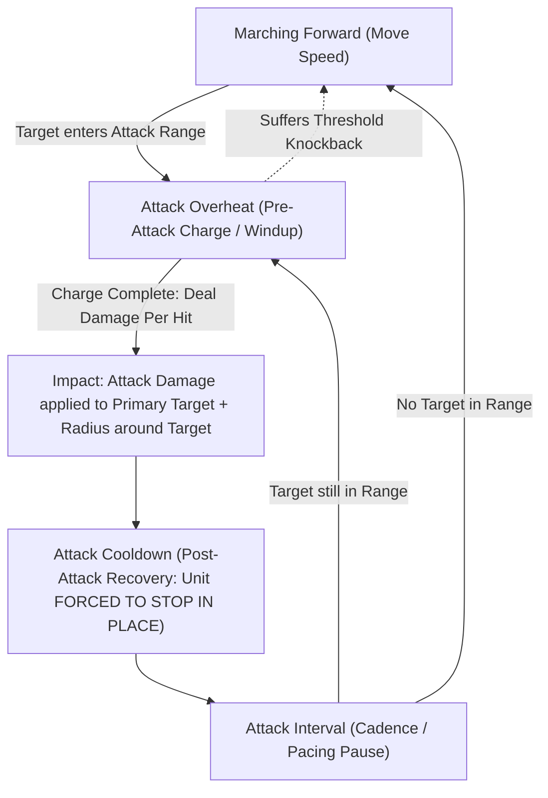
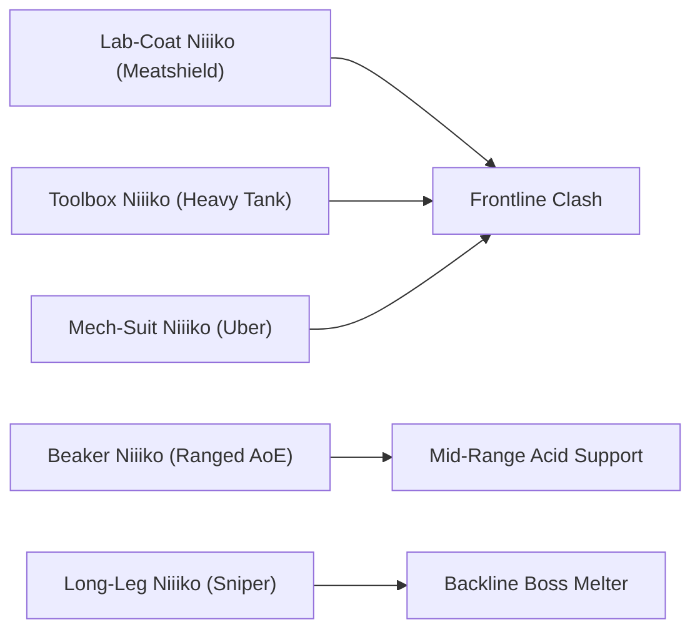

# Niiiko vs Human: Cat Girl Defense (Working Title)

| Command an army of quirky lab cat-girls to establish sovereign Niiiko rule across the globe!
| Product Vision, Modular Lane Combat Architecture & Hybrid-Casual Monetization GDD
| ET STUDIO / 2026

---

## Game Concept

| Concept                  | Value                                                                                                                                                                                                                                                                                                                                                                                                                                                                                                                                                                                                                                                                                                                                                                                                                                                                                       |
| :----------------------- | :------------------------------------------------------------------------------------------------------------------------------------------------------------------------------------------------------------------------------------------------------------------------------------------------------------------------------------------------------------------------------------------------------------------------------------------------------------------------------------------------------------------------------------------------------------------------------------------------------------------------------------------------------------------------------------------------------------------------------------------------------------------------------------------------------------------------------------------------------------------------------------------ |
| **Title**                | **Niiiko Wars: Cat Girl Defense** / **Niiiko vs Human: Cat Girl Defense**                                                                                                                                                                                                                                                                                                                                                                                                                                                                                                                                                                                                                                                                                                                                                                                                                   |
| **Subtitle**             | 2D Side-Scrolling Cat-Girl Tower Defense & Lane Battler                                                                                                                                                                                                                                                                                                                                                                                                                                                                                                                                                                                                                                                                                                                                                                                                                                     |
| **Description**          | **Niiiko vs Human: Cat Girl Defense** is a fast-paced, comedic 2D side-scrolling lane defense mobile game where players command an army of quirky, lab-coat-wearing cat-girls (Niiikos) on a crusade to liberate Earth from greedy, inefficient, and ridiculous human rule. From clandestine underground research laboratories, the Niiikos march across Earth's major cultural metropolitan hubs—deploying scientific slapstick combat against frantic street swarms, greasy corporate suits, and goofy municipal bosses. Featuring a high-tension dynamic knockback tug-of-war system, manual emergency super-weapon particle blasts, chapter-based continental relic progression, deep unit leveling, and a high-LTV hybrid monetization framework (Rewarded Ads + Interstitials + IAP Starter Bundles), the game is engineered for low install friction and long-term global retention. |
| **Genre**                | 2D Side-Scrolling Tower Defense / Lane Battler / Casual Strategy                                                                                                                                                                                                                                                                                                                                                                                                                                                                                                                                                                                                                                                                                                                                                                                                                            |
| **Theme**                | Anime cat-girl sci-fi parody, slapstick comedy, whimsical laboratory science vs. ridiculous human caricatures                                                                                                                                                                                                                                                                                                                                                                                                                                                                                                                                                                                                                                                                                                                                                                               |
| **Setting**              | Major Earth metropolitan hubs and cultural centers (Chapter 1 MVP: Southeast Asia — Vietnam old town alleyways, Thailand neon night markets, Singapore futuristic high-rise CBD) and clandestine Niiiko mobile research labs                                                                                                                                                                                                                                                                                                                                                                                                                                                                                                                                                                                                                                                                |
| **Player Role**          | The Niiiko Field Commander / Supreme Lab Overseer, directing real-time resource allocation, troop summoning order, and tactical Particle Blaster orbital strikes                                                                                                                                                                                                                                                                                                                                                                                                                                                                                                                                                                                                                                                                                                                            |
| **Core Gameplay**        | Push the frontline forward on a horizontal lane to reveal build slots, spend **Coins (Cat Coins)** to claim paved foundation slabs and construct tactical buildings (Fish Cannery, Fortified Mound Barricade, Research Lab) as forward rally points, and spend **Food (Fish Cans)** to summon quirky Niiiko combatants to clash with advancing human waves, protect your vulnerable supply chain, trigger cartoon knockbacks, and destroy the enemy outpost |
| **Objective**            | March across the battlefield, expand territory slot-by-slot, protect forward supply chain buildings from being destroyed, overwhelm incoming human waves, push back boss units, and reduce the human city outpost's HP to 0 while defending the Niiiko Research Lab on the left edge of the screen |
| **Progression**          | Clear Chapter 1 (15 stages across Vietnam, Thailand, and Singapore), unlock permanent regional Relic buffs, spend earned **EXP** in the Main Menu to unlock new cat-girls into your roster, manage auto-regenerating **Energy** to launch battles, and advance toward global domination                                                                                                                                                                                                                                                                                                                                                                                                                                                                                                                                                                                                     |
| **Unique Selling Point** | 1. **Progressive Territory Expansion & Forward Rally System (Slot System)**: Unlike *The Battle Cats* where the lane is completely inert and backlines are untouchable, players actively conquer ground slab-by-slab, constructing tactical buildings (Fish Cannery, Fortified Barricade Mound, Research Lab) that double as forward troop rally points, dramatically shortening march distance.<br>2. **Vulnerable Supply Chain & Hazard Mechanics**: High-risk / high-reward tactical tension—human attackers will halt to attack and destroy your economic buildings, reducing them to ruins and causing supply collapse if frontline defense breaks.<br>3. **Dynamic Burst Knockback Physics**: Burst-damage thresholds force units backward into visual cartoon tumbles, turning lane battles into an elastic, nail-biting tug-of-war rather than static hitpoint attrition.<br>4. **Weaponized Cat-Girl Science vs. Degenerate Humans**: Hilarious weaponized lab gear (acid beakers, wrench whacks, laser pointers, piston mechas) colliding with parody human stereotypes (awkward disco-dancing uncles, smile-scamming influencers, net trappers).<br>5. **Original Ergonomic Landscape HUD**: Cute cat-eared top-left Food & Coin plaque, top-right slot tracker (`3/5`) and battle timer, lower-left syringe dial for base cannon firing, and bottom-right `Summoning Deck` (as illustrated in `Demo Map.png`). |
| **Art Style**            | 2D clean cell-shaded/vector cartoon anime aesthetic with expressive, hand-drawn sprite animations, thick cell outlines, exaggerated squash-and-stretch slapstick, and zero blood or graphic violence                                                                                                                                                                                                                                                                                                                                                                                                                                                                                                                                                                                                                                                                                        |
| **Audio (BGM/SFX)**      | Upbeat electro-swing marching brass and playful anime pop BGM; comical cartoon SFX (squeaky wrench thwacks, bubbling acid fizz, laser pointer buzzes, disco synth stings, and funny cartoon "poof" defeat noises)                                                                                                                                                                                                                                                                                                                                                                                                                                                                                                                                                                                                                                                                           |
| **Target Audience**      | Mobile casual gamers, anime/cat-girl enthusiasts, fans of *The Battle Cats*, *Cartoon Wars*, and humorous lane defense titles (All genders, ages 12–35)                                                                                                                                                                                                                                                                                                                                                                                                                                                                                                                                                                                                                                                                                                                                     |
| **Platform**             | Mobile: Android primary (Google Play), iOS secondary (App Store) — Landscape orientation (`16:9` / `19.5:9` wide lane display)                                                                                                                                                                                                                                                                                                                                                                                                                                                                                                                                                                                                                                                                                                                                                              |

---

## References

- **Battlefield Visual Mockup (Demo Map):** [Demo Map.png](Demo%20Map.png)
  
- **UI / UX Flow (Figma):** `TBD — Landscape 16:9 Mobile Flow (Title / World Map -> Deck Setup -> Battle Screen [Lab on Left / City on Right] -> Victory / Defeat Popup -> Lab Research Upgrade)`
- **Game Data Sheet:** [`link`](https://docs.google.com/spreadsheets/d/1ks_tdjPYvBlGu7S6V8U2rc7-jrp7gqmgjHkIacJmhYc/edit?usp=sharing) (Unit combat stats, enemy spawn pacing, and relic formulas)
- **Visual / Market References:**
  - *The Battle Cats* (PONOS) — Reference for comedic lane deployment, knockback tension, and cannon wiping. *Key divergence:* Niiiko vs Human introduces active progressive territory expansion (paved foundation slabs, forward building construction, vulnerable supply chains, and forward rally deployment).
  - *Line Rangers* / *Cartoon Wars* — Accessible mobile unit summoning, charming comedic unit animations, and character-driven progression.

---

## Game cycle

Each stage in **Niiiko vs Human: Cat Girl Defense** delivers a thrilling, accessible **60-to-120 second tactical battle cycle** designed for high session velocity, bite-sized mobile play, and natural ad-monetization touchpoints.

```
[World Map / Stage Selection]
           │ (Spends 10 Energy [Main Menu])
           ▼
[Lane Battle: Push Frontline ──► Reveal Ghost Build Slots (+)]
           │                              │ (Pay Coins to Claim Slabs)
           │                              ▼
           │                     [Construct Buildings: Cannery / Mound / Lab]
           │                              │ (Acts as Forward Rally Point)
           ▼                              ▼
[Summon Niiiko Units with Food] ◄─────────┘
           │
           ├──► [Defend Supply Chain Buildings Against Advancing Humans]
           │
           ├──► [Deploy Particle Blaster (Cat Coins)]
           │
           ▼
     [Victory / Defeat]
           │
     ┌─────┴────────────────────────────────┐
     ▼                                      ▼
[Victory: Earn EXP & Relics]           [Defeat: Watch Ad Revive / Free Retry]
     │                                      │
     ▼                                      ▼
[Main Menu: Spend EXP to Unlock New Cats]  [Adjust Deck / Regenerate Energy]
     │
     ▼
[Unlock Next Global Region & Relic Buff]
```

- **Step 1 (Preparation / Input — Deck Check & Stage Launch):**
  - The player selects a stage on the World Map (spends `10 Energy`, a Main Menu currency that auto-regenerates over time).
  - The player reviews their active 5-to-10 unit deployment deck, equips any collected Continental Relics, and taps **"To Battle!"**.
  - The match initializes with the player's **Niiiko Mobile Lab** on the far left (`100% HP`), **0 forward build slots claimed**, and the **Human City Outpost** on the far right (`100% HP`).
- **Step 2 (Active Phase — Resource Management, Territory Expansion & Lane Combat):**
  - **In-Battle Resource 0 — Food (Fish Can):** Food accumulates continuously during battle based on base rates and active **Fish Cannery** buildings. Used exclusively in battle to buy and deploy Niiiko units onto the lane.
  - **In-Battle Resource 1 — Coin (Cat Coin):** Cat Coins are earned during combat by dealing damage, triggering knockbacks, and defeating human enemies, as well as from **Research Labs**. Used exclusively in battle to claim foundation slabs, construct/upgrade buildings, and discharge in-battle weapons (Niiiko Particle Blaster).
  - **Progressive Territory Expansion (Slot System):** As Niiikos push human waves rightward, ghost outlines with glowing `+` indicators are revealed sequentially (left to right). Players spend Coins to pave grey foundation slabs and construct specialized buildings:
    - *Fish Cannery:* Boosts passive Food income (`+X Food/sec`) to fuel rapid swarm deployment.
    - *Fortified Barricade (Mound):* High-health chokepoint bunker that resists enemy pushes and protects rear assets.
    - *Research Lab:* Generates extra Coins (`+Y Coins/wave`) or applies army-wide attack modifiers.
  - **Forward Rally Deployment:** Units spawn directly from the furthest forward active building rather than walking across the entire map, creating aggressive battlefield tempo.
  - **Supply Chain Hazard & Defense:** If human enemies push back Niiiko lines, they stop and actively attack forward buildings. If a building's HP reaches 0, it collapses into an "Empty Ruin", stripping away its buffs until repaired.
  - **Dynamic Combat & Knockback:** Upon reaching attack range of an opposing human, building, or outpost, units automatically initiate combat according to attack speed and reach. Dealing threshold burst damage triggers dynamic knockback, tumbling units backward.
  - **In-Battle Super Weapon Activation:** When human swarms threaten forward barricades or the Main Base, the player spends **Coins (Cat Coins)** to fire the **Niiiko Particle Blaster**, sweeping the screen with heavy AoE damage and multi-knockback.
- **Step 3 (Completion / Climax):**
  - **Win Trigger:** The human city outpost's HP is reduced to `0`. Human forces flee with comical sweat drops and cartoon dust clouds. A cheerful victory screen displays stage completion time, EXP earned (to unlock new cats in the Main Menu), and any newly discovered Regional Relics.
  - **Fail Trigger:** The Niiiko Mobile Lab's HP is reduced to `0`. Frontline cat-girls retreat in tears. The defeat screen offers an **Emergency Ad Revive** (restores lab to `50% HP` and wipes active lane enemies) or a direct retry.
- **Result:**
  - Clearing a stage grants **EXP (Main Menu Currency)** to unlock new cats in the roster, **Chapter Relic Progress**, and unlocks the next contiguous stage along the global conquest route.

**Key Aspects of Every Cycle:**
- **Progress Tracking:** Visible in real-time via the **Active Slabs Counter (e.g. `3/5`)** (top-right), the **Human Outpost HP Bar**, the **Battle Timer (`Tim 10m`)**, and the **Particle Blaster Charge Dial** (lower-left).
- **Base Duration of a Single Cycle:** `45–90 seconds` on standard stages; `90–150 seconds` on milestone Chapter Boss stages.
- **Cycle Time Scaling Rules:**
  - **Stages 1–5 (Vietnam):** `45–60 seconds` average clear time (fast onboarding, 2–3 build slots).
  - **Stages 6–10 (Thailand):** `60–90 seconds` average clear time (medium lanes, 4–5 build slots, heavy counter-rushes).
  - **Stages 11–15 (Singapore):** `90–120 seconds` average clear time (expanded lanes, 5–6 build slots, high-armor corporate bosses attacking supply lines).
- **Ways to Reduce or Speed Up Cycle Time:**
  - **2x Battle Speed Toggle:** Unlocked after clearing Stage 3; accelerates in-match physics and timers by `200%`.
  - **Forward Rally Rush:** Rapidly claiming slabs and building Fish Canneries allows instant frontline reinforcement, suffocating enemy spawns at their outpost.
  - **Niiiko Particle Blaster:** Instantly vaporizes low-tier swarms and clears the lane for fast base siege (requires Cat Coins).
  - **Pre-Battle Power-Ups (Rewarded Ad / Consumable):**
    - *Catnip Overdrive:* Match starts with `+200 Initial Food (Fish Cans)` and `+150 Initial Coins (Cat Coins)`.
    - *Sniper Niiiko Drone:* An automated orbiting drone assists from off-screen, sniping distant enemies every `8 seconds`.
- **How Player Choices Affect the Cycle Outcome:**
  - **Greedy Economy vs. Line Defense:** Building too many Fish Canneries without a Fortified Mound leaves forward investments vulnerable; when human tanks break through, destroyed buildings cause economic collapse. Balancing economy buildings, defensive chokepoints, and Coin reserves for cannon fire dictates victory.

---

## Game reward

Completing battles rewards players with immediate resources to unlock new cats and manage their session energy.

- **Base Cycle Reward:**
  - **EXP (Main Menu Currency):** `150–600 EXP` based on stage tier (`+100%` bonus on first-time clear). Stored in the Main Menu to unlock new cats in the Niiiko Lab Roster.
  - **Energy (Main Menu Currency - Auto-Regen):** Auto-recharges passively (`1 Energy` recovered every `2.5 minutes`, cap `100`).
- **Variable / Drop Reward:**
  - **Regional Relic Drops:** Each region has a `15%–25%` drop chance per clear until the relic is acquired:
    - *Vietnam:* **Drip Coffee Relic** (+10% Unit Movement Speed).
    - *Thailand:* **Golden Spices Relic** (+10% In-Battle Food Generation Speed).
    - *Singapore:* **Transit Card Relic** (-8% Food Deployment Cost for all units).
  - **Bonus EXP Capsules:** Awarded on all milestone boss stages (every 5th stage) to fast-track cat unlocks.
- **Final Reward Formula:**
  $$\text{Final EXP} = (\text{Base Stage EXP} + \text{Clear Speed Bonus}) \times \text{Ad Multiplier} \times \text{Relic Multiplier}$$
  - Where $\text{Clear Speed Bonus} = \max\left(0, \lfloor (120 - \text{ClearTimeSec}) \times 2.5 \rfloor\right)$.
- **Reward Modified by Ad:**
  - **Double Rewards Offer (Victory Screen):** Watching 1 Rewarded Ad multiplies EXP earned by **`2x`** and doubles any dropped Relic fragment count.
- **Reward Modified by Mechanics:**
  - **Relic Synergy:** Unlocking all 3 Regional Relics in Chapter 1 activates the **Continental Master Buff**, providing an additional permanent `+15% EXP` across all game modes.

---

## Core gameplay

**Niiiko vs Human: Cat Girl Defense** is built on a tight, strategic 2D lane-battler system where timing, deck synergy, and resource optimization dictate victory.

### (1) In-Battle Economy & Dual Resource System
The in-battle economy is driven by two distinct tactical resources: **Food (Fish Can)** to buy units and **Coins (Cat Coins)** to fund territory expansion, building construction, and super-weapons.

- **Mechanic Overview:**
  - **Food (Fish Can):** Automatically accumulates in real time at a base rate (`15 Food/s`), boosted significantly by constructed **Fish Cannery** buildings. All unit summonings cost Food.
  - **Coin (Cat Coin):** Dropped during active combat as human enemies take burst damage, suffer knockbacks, and get defeated, and supplemented by **Research Labs**. Used in battle to claim foundation slabs, construct/upgrade buildings, and fire the Base Super Weapon.
  - **Upgrading the Worker Gauge:** Integrated into the top-left **Circular Laboratory Gauge**. Tapping it spends in-battle **Coins (Cat Coins)** to increase baseline Food generation ($R_{\text{Food}}$) and maximum Food capacity ($C_{\max\text{Food}}$).
- **Worker Level Scaling Table:**

| Worker Level | Upgrade Cost (Cat Coins) | Base Food Tick Rate (Fish Cans/s) | Max Food Storage (Fish Cans) | Strategic Role |
| :--- | :--- | :--- | :--- | :--- |
| **Level 1** | Base (0) | `15 Food/s` | `100 Food` | Opening swarm defense / meatshield deployment |
| **Level 2** | `60 Coins` | `24 Food/s` | `200 Food` | Establish frontline stability; deploy Toolbox Niiiko |
| **Level 3** | `120 Coins` | `36 Food/s` | `350 Food` | Transition to ranged AoE Beaker Niiiko support |
| **Level 4** | `200 Coins` | `52 Food/s` | `550 Food` | Save up for Long-Leg Niiiko sniper deployment |
| **Level 5** | `320 Coins` | `72 Food/s` | `800 Food` | Mid-battle pressure against enemy tanks |
| **Level 6** | `480 Coins` | `96 Food/s` | `1,100 Food` | Economy threshold required to summon Mech-Suit Niiiko |
| **Level 7** | `680 Coins` | `125 Food/s` | `1,500 Food` | Endgame lane flood & aggressive boss siege |
| **Level 8 (MAX)** | `950 Coins` | `165 Food/s` | `2,000 Food` | Maximum swarm spamming; overwhelm base defenses |

- **Design Purpose:** Forces dynamic tactical trade-offs: balancing Coin expenditure between Worker Gauge upgrades, claiming territory slabs, erecting supply buildings, and reserving Coins for emergency Particle Blaster weapon discharges.

### (2) Progressive Territory Expansion (Slot System)
The **Progressive Territory Expansion (Slot System)** represents the core structural innovation distinguishing **Niiiko vs Human** from traditional lane defense games like *The Battle Cats*. The single horizontal lane is not an inert corridor; it is a contested supply chain territory where commanders claim foundation ground, erect specialized tactical structures, and establish forward spawn rally points.

*(Reference visual: [Demo Map.png](Demo%20Map.png) showcasing the Main Base on the left, sequential foundation slabs, constructed Fish Canneries, Mound Bunker Barricade, and an active ghost `+` slot indicator).*

#### 1. The Core Mechanic: Ghost Slabs & Territory Discovery
- **Match Start Condition:** The match initializes with only the player's Main Base (**Niiiko Mobile Lab**) on the far left edge of the battlefield and **0 forward build slots claimed**.
- **Frontline Discovery Trigger:** As Niiiko combatants push human enemies backward across the lane, the next available forward build location is revealed as a **translucent ghost outline with a glowing yellow `+` indicator**.
- **Visual Feedback:** A pulsating golden aura highlights the open build slot, alerting the player that frontline ground has been captured and is ready to be paved.

#### 2. Claiming Slabs: Foundation Paving & Sequential Unlocking
- **Strict Sequential Order:** Slabs must be unlocked strictly in sequence from **left to right** (Slot 1 $\rightarrow$ Slot 2 $\rightarrow$ Slot 3 $\dots$). Players cannot skip ahead to distant slots without securing and claiming the preceding foundation.
- **Scaling Paving Cost:** Claiming an open slot costs in-battle **Coins (Cat Coins)**, scaling with distance from the Main Base:
  $$\text{Slab Cost}(S) = 50 \times S^{1.35}$$
  *(e.g., Slot 1: `50 Coins`, Slot 2: `130 Coins`, Slot 3: `220 Coins`, Slot 4: `330 Coins`, Slot 5: `450 Coins`).*
- **Paved Foundation:** Upon paying the Coin cost, the slot transforms into a **solid paved grey foundation slab** featuring mechanical mounting docks and an interactive construction selector.

#### 3. Building Construction: Real-Time Tactical Choice
Tapping an open, paved grey slab presents the player with a real-time choice between three specialized scientific facilities:

| Building Type | In-Game Visual (`Demo Map.png`) | Construction Cost | Base HP | Primary Output / Effect | Strategic Role |
| :--- | :--- | :--- | :--- | :--- | :--- |
| **Fish Cannery** | Purple cylindrical cannery, pink conical roof, turning top gear, fish door emblem, green liquid beaker | `80 Cat Coins` | `1,200 HP` | **`+8 Food / sec`** passive income boost | **Economic Swarm Engine:** Stacking canneries creates massive Food surplus to spam meatshield swarms and afford Tier 4–5 units. |
| **Fortified Barricade (Mound)** | Grassy sandbag earthwork bunker with reinforced slit opening and top rotating radar dish | `120 Cat Coins` | `3,500 HP` | **Physical Roadblock & Passive Retaliation:** Absorbs heavy strikes; fires periodic dart bursts (`40 Attack Damage per hit` / `1.5s Interval`) | **Chokepoint Anchor:** Halts advancing human tanks, absorbs shock damage, and shields fragile rear canneries. |
| **Research Lab** | High-tech steel laboratory kiosk with bubbling chemical flasks and orbital communication antenna | `150 Cat Coins` | `1,500 HP` | **`+15 Coins / wave`** + **`+5% Battlefield Attack Damage (per hit)`** to all active Niiiko units | **Tactical Multiplier:** Accelerates Coin drip for weapon discharges and enhances total army Attack Damage (per hit). |

- **Upgrade & Scrap Actions:**
  - Tapping a built structure allows the player to upgrade it (up to Level 3) using Coins to boost its HP and output (+50% per level).
  - Players may **Scrap** a building at any time, refunding `50%` of its original Coin cost to immediately construct a different facility on that slab (e.g., demolishing a Cannery to place an emergency Fortified Barricade when a boss enters).

#### 4. Hazard Level: Protecting Your Supply Chain
In *The Battle Cats*, the backline is completely invulnerable and deployed units merely walk down an empty path. In **Niiiko vs Human**, the supply chain is physically vulnerable:

- **High Risk / High Reward:** Forward buildings produce immense economic and tactical momentum, but they represent physical targets directly on the combat lane.
- **Enemy Siege Behavior:** If human swarms or heavy enemy bosses push through your frontline combatants, they do NOT walk harmlessly past your buildings. **Enemies halt and actively attack your economic structures**, dealing contact and weapon damage.
- **Destruction & Reclamation:**
  - If a building's HP drops to `0`, it collapses into a smoldering **"Empty Ruin"** (blackened rubble with cartoon smoke puffs).
  - **Immediate Economic Loss:** Its resource bonus (+Food/s or +Coin buff) is instantly terminated, risking supply starvation.
  - **Reclamation Fee:** Before a destroyed slot can be reused, players must push the frontline back past the ruins and pay a **Reclamation Fee (`50% of original Slab Cost` in Coins)** to clear the rubble and restore the paved slab.
- **Aggressive Advantage: Forward Rally Deployment:**
  - Forward claimed slabs act as **Advanced Spawn Rally Points**.
  - Newly summoned Niiikos exit directly from the **furthest forward active building** rather than traversing the entire map from the Main Base.
  - **Tactical Impact:** Cuts travel time to the frontline by up to `75%`, allowing players to instantly reinforce the line, trap enemies against their city outpost, and maintain relentless forward pressure. However, losing that forward building forces spawns backward, instantly ceding lane advantage.

### (3) Tactical Lane Summoning, Unit Roles & Dynamic Knockback
The single horizontal lane functions as a tug-of-war battleground where positioning, range, and burst damage determine line stability.

| Occurrence | Trigger Timing | Role | Effect |
| :--- | :--- | :--- | :--- |
| **Frontline Stall** | Early game (`0–20s`) | Stall fast rusher units | Cheap Lab-Coat Niiikos absorb hits and hold line position |
| **Territory Discovery** | Line pushes past slot marker | Reveal building opportunities | Ghost outline with glowing `+` appears; ready for slab paving |
| **Damage Threshold Knockback** | Burst damage reaches $\ge \text{Knockback Limit}$ | Defensive breathing room & lane reset | Unit plays a tumbling cartoon animation, slides back `80px`, and cancels current attack windup |
| **Counter-Attack Push** | Heavy tank / sniper deployment (`40–80s`) | Clear swarms and push enemy back | High-damage AoE units melt frontline enemies and advance toward enemy base |
| **Supply Line Siege** | Enemies breach vanguard and reach buildings | High-tension defense priority | Enemies halt to attack Canneries/Barricades; player must react before structures collapse |
| **Emergency Screen Wipe** | Enemy swarms reach within `150px` of player lab | Prevent catastrophic defeat | Particle Blaster fires, clearing all non-boss units and resetting line |

- **Knockback Formula:**
  $$\text{Damage for Knockback} = \frac{\text{Unit Max HP}}{\text{Knockback Count}}$$
  - Example: A Greasy Uncle with `3,000 HP` and `3 Knockbacks` tumbles backward every time he absorbs `1,000 damage`. Clever timing of high-burst attacks knocks him back repeatedly before he can hit the frontline.
- **Example Gameplay Case (Territory & Combat Synergy):**
  - **Stage 8 (Thailand Night Market):** Two *Trench-Coat Dashers* rush early. The player deploys two *Lab-Coat Niiikos* (`50 Food` each) from the Main Base to stall them, earning initial Coins from the clash.
  - The vanguard pushes forward, revealing **Slot 1 (`+`)**. The player spends `50 Coins` to pave the slab and constructs a **Fish Cannery** (`80 Coins`), immediately boosting Food generation by `+8 Food/s`.
  - With accelerated Food income, the player deploys *Toolbox Niiiko* (`120 Food`) directly from the Cannery (forward rally spawn!).
  - As the line pushes further, **Slot 2 (`+`)** is claimed (`130 Coins`) and fortified with a **Fortified Barricade (Mound)** (`120 Coins`, `3,500 HP`).
  - A *Greasy Uncle* enters doing his flailing disco shuffle, mowing down the light vanguard and halting to attack the Fortified Mound. The Mound absorbs his hits, buying time for *Beaker Niiiko* (`220 Food`) and *Long-Leg Niiiko* (`450 Food`) to spawn directly behind the barricade.
  - A laser burst triggers a cartoon knockback stumble on the Greasy Uncle, saving the barricade from ruin and securing the forward push!

### (4) Base Super Weapon: Niiiko Particle Blaster (In-Battle Weapon)
Mounted upon the Niiiko Mobile Lab, the Particle Blaster is an experimental super-science directed-energy cannon designed for clutch defensive reversals, powered and activated in-battle using **Coins (Cat Coins)**.

| Name | Category | Description |
| :--- | :--- | :--- |
| **Standard Particle Beam** | Active In-Battle Weapon | Spend `150 Cat Coins` to fire a sweeping turquoise energy laser across the battlefield, dealing heavy AoE damage and applying guaranteed knockback. |
| **Cryo-Stabilizer Boost** | In-Battle Weapon Upgrade | Spend `250 Cat Coins` to add a `2.5-second` freeze/slow debuff to all surviving human enemies hit by the beam. |
| **Overdrive Ad Recharge** | Emergency In-Battle Offer | When base HP drops below `30%`, watching 1 Rewarded Ad grants an instant free Cannon discharge and temporary invulnerability shield for `5 seconds`. |

**UI & In-Battle Weapon Scaling:**
- **UI Name:** **Particle Blaster Syringe Dial** (lower-left in-match HUD).
- **Rules & Constraints:** Requires in-battle Cat Coins to activate; base cooldown starts at `60.0 seconds` and can be reduced with tactical in-match weapon upgrades.

| ID | Upgrade / Action Name | In-Battle Cost | Effect |
| :--- | :--- | :--- | :--- |
| **W1** | **Standard Blast** | `150 Cat Coins` | Fires full-screen beam dealing `500 Damage` + knockback |
| **W2** | **Overcharge Boost** | `300 Cat Coins` | Increases next blast damage by `+50%` (`750 Damage`) |
| **W3** | **Cryo-Stabilizer** | `250 Cat Coins` | Adds `2.5s` freeze/slow debuff to hit enemies |

- **Cannon Firing Formula:**
  $$\text{Damage}_{\text{Cannon}} = \text{BaseCannonDamage} \times \left(1 + 0.2 \times (\text{OverchargeTier})\right) \times \text{RelicBonus}$$

### (5) World Map & Chapter Progression (Southeast Asia MVP: Vietnam, Thailand, Singapore)
Progression unfolds across real-world global regions where players topple local human authorities to establish sovereign Niiiko research branches.

| Region | Stages | Environment & Thematic Gimmick | Completion Relic Reward |
| :--- | :--- | :--- | :--- |
| **Vietnam** | Stages 1–5 | Old town alleyways, motorcycle rushers, street-cart barricades. Fast-paced swarm encounters. | **Drip Coffee:** `+10%` Movement Speed across all active Niiiko units. |
| **Thailand** | Stages 6–10 | Vibrant night markets, neon tuk-tuks, street food shielders. Introduces debuffers and heavy dancers. | **Golden Spices:** `+10%` In-Battle Food Generation Speed. |
| **Singapore** | Stages 11–15 | Futuristic high-rise CBD, security drones, high-tech boss barricades. High-armor corporate enemies. | **Transit Card:** `-8%` Food Deployment Cost on all Niiiko units. |


- **Regional Relic Synergy:**
  - Collecting all 3 Relics in Chapter 1 unlocks the **Southeast Asia Grand Sovereign Trophy**, providing an account-wide `+15% EXP` bonus and granting the exclusive **UR Scientist Niiiko Skin**.

### (6) Collection & Main Menu Cat Unlocking (EXP System)
The **Niiiko Research Codex & Lab Roster** allows players to spend accumulated **EXP (Currency 2)** in the Main Menu to unlock new cats / cat-girls for their deployment deck.

- **Main Menu Cat Unlock Mechanics:**
  - EXP earned from stage victories and daily missions is saved exclusively in the Main Menu.
  - Players enter the **Niiiko Lab Roster** to view locked and unlocked cat combatants across base role archetypes and cosmetic tiers.
  - Spending the required EXP permanently unlocks the cat-girl for deck construction.
- **Roster Unlock Tiers (EXP Cost in Main Menu):**

| Cat Unit | Base Role Archetype | Cosmetic Rarity (Cosmetic Only) | Main Menu EXP Unlock Cost |
| :--- | :--- | :--- | :--- |
| **Lab-Coat Niiiko** | Meatshield | N | `Unlocked by Default (0 EXP)` |
| **Toolbox Niiiko** | Heavy Tank | R | `300 EXP` |
| **Beaker Niiiko** | Ranged AoE | R | `800 EXP` |
| **Long-Leg Niiiko** | Sniper | SR | `2,000 EXP` |
| **Mech-Suit Niiiko** | Uber Finisher | SSR | `5,000 EXP` |

- **Collection Milestone Rewards:**
  - **40% Codex Completion:** `+1,000 Bonus EXP` + `2 Energy Refills (100 Energy each)`.
  - **80% Codex Completion:** `+3,000 Bonus EXP` + `5 Energy Refills`.
  - **100% Codex Completion:** Exclusive **SSR Golden Lab-Coat Niiiko** + permanent `+10% Base HP` to the Mobile Lab.

### (7) Research Lab & Special Variants (Optional Gacha / Skins)
Beyond direct EXP unlocking in the Main Menu, the **Lucky Lab Capsule Machine** offers cosmetic skins and variant costumes.

- **Capsule Cost:**
  - **Single Pull:** `150 Niiiko Gems` OR `1 Lucky Ticket` OR **1 Daily Free Ad Pull** (cooldown: 24h).
  - **10x Pull Bundle:** `1,350 Niiiko Gems` (10% discount, guarantees at least 1 SR variant or skin).
- **Rarity Drop Rates:**
  - **Normal (N):** `50.0%`
  - **Rare (R):** `32.0%`
  - **Super Rare (SR):** `12.5%`
  - **Super Super Rare (SSR):** `4.5%`
  - **Ultra Rare (UR):** `1.0%`
- **Pity & Duplicate System:**
  - Every pull awards `+10 Pity Points`. At `100 Points (10 pulls)`, the next pull is guaranteed an **SR or higher**. At `300 Points (30 pulls)`, the player receives a guaranteed **SSR or UR Unit Capsule**.
  - Duplicate units are converted into **Unit DNA Shards**, used to unlock cosmetic skin chromas, special visual particle trails, entrance animations, and codex collector prestige (cosmetic only; zero combat stat impact).

### (8) Daily Rewards (option)
A 7-day login calendar designed to drive Day-1 to Day-7 retention, accessible via the main menu and automatically triggered on first daily launch.

| Day | Reward Type | Amount |
| :--- | :--- | :--- |
| **Day 1** | EXP (Main Menu) | `500 EXP` |
| **Day 2** | Niiiko Gems | `100 Niiiko Gems` |
| **Day 3** | Cat Unlock | **Beaker Niiiko (Rare)** |
| **Day 4** | EXP (Main Menu) | `1,500 EXP` |
| **Day 5** | Energy Battery Packs | `3 Full Energy Recharges` |
| **Day 6** | Niiiko Gems | `250 Niiiko Gems` |
| **Day 7** | Exclusive SSR Cat | **Cyber-Niiiko (SSR)** (or `3,000 EXP` if owned) |

- **Buttons:**
  - **Claim (1x):** Collects standard day reward.
  - **Double with Ad (2x):** Watching 1 Rewarded Ad doubles currency/pack quantities.
  - **Catch-Up Day:** Missing a day allows catching up by watching 1 Rewarded Ad.
- **Mechanisms:**
  - Resets at `00:00` local device time. After Day 7 is claimed, the calendar loops into a recurring Weekly Science Grant.

### (9) Daily Missions (option)
Daily missions focus on reinforcing core combat participation and voluntary ad monetization.

| ID | Mission name | Reward | Required |
| :--- | :--- | :--- | :--- |
| **1** | **Field Research** | `300 EXP` | Clear `3` battles in any region |
| **2** | **Mass Mobilization** | `300 EXP` | Deploy `30` Niiiko units total |
| **3** | **Particle Discharge** | `50 Niiiko Gems` | Fire the Niiiko Particle Blaster `2` times |
| **4** | **Human Countermeasure** | `400 EXP` | Defeat `10` Greasy Uncle or Heavy human units |
| **5** | **Lab Sponsor** | `50 Gems` + `1 Energy Pack` | Watch `2` Rewarded Ads (Double Reward, Energy, or Boost) |
| **6** | **Daily All-Clear Bonus** | `1,000 EXP` + `1 Energy Pack` | Complete all `5` Daily Missions today |

### (10) IAP Shop (option)
An integrated storefront offering convenience packages, premium currencies, and cosmetic customization.

- **Store Architecture:** Divided into 4 clear tabs: *Special Bundles*, *Gems Bank*, *Laboratory Supplies (Energy/Boosters)*, and *Costumes*.
- **Store Expansion:** Native integration with Google Play Billing and Apple StoreKit with receipt validation.

### (11) Rating UI (option)
- **Trigger Timing:** Prompts the player after high-dopamine milestone moments:
  1. Immediately following victory on **Stage 10 (Thailand Final Stage)**.
  2. Immediately upon unlocking a first **SSR or UR Cat-Girl** with EXP.
- **Frequency & Cooldown:** Appears at most once every 14 days; suppressed permanently if the user submits a rating.
- **UI Flow:** Cute pre-prompt featuring Lab-Coat Niiiko asking: *"Are you enjoying the Cat-Girl scientific revolution?"*
  - If *"Yes, Love it!"* (`5 Stars`) $\rightarrow$ Redirects to native Google Play / App Store review dialog.
  - If *"Needs Improvement"* $\rightarrow$ Opens in-game feedback form to capture complaints privately.

### (12) FAQ
- **Access Point:** Located inside the **Settings Menu** via the *"Lab Handbook & Support"* icon.
- **Display Method:** Native scrollable accordion popup list with fast in-memory display (no webview dependency).
- **Question Categories:**
  - *Gameplay Mechanics:* How does knockback work? What do Regional Relics do? How do Food (Fish Cans) and Cat Coins work in battle?
  - *Account & Energy:* How does Energy auto-regenerate? How to spend EXP to unlock new cats? How to restore purchases?
  - *Troubleshooting:* What to do if an ad fails to load or energy is desynced?
- **Contact Support Link:** Dedicated *"Contact Head Researcher"* button generating a pre-filled support email with User ID, device OS, and app version.

### (13) Tutorial
- **Trigger Condition:** Automatically activates upon the first app launch (`FirstTimeUser == true`).
- **Tutorial Type:** Lightweight, non-intrusive interactive onboarding across Stages 1–3.
- **Step-by-Step Flow:**
  - **Stage 1 (Vietnam Alley):** Guided finger highlight shows the **Food (Fish Can)** gauge accumulating; prompts player to buy and summon their first *Lab-Coat Niiiko* (`50 Food`); demonstrates pushing the frontline forward to reveal the first **Ghost Slot (`+`)**; guides player to spend Coins to pave the slab and construct a **Fish Cannery**.
  - **Stage 2:** Teaches building a **Fortified Barricade (Mound)** to anchor against rusher units; demonstrates forward rally deployment where units exit directly from the forward barricade.
  - **Stage 3:** Demonstrates enemy pressure against forward buildings and teaches spending **Coins (Cat Coins)** to fire the *Niiiko Particle Blaster* to save the supply line; completes FTUE, directs player to the Main Menu, and awards `500 Bonus EXP` to unlock their first new cat.
- **Skip & Replay Rules:** Tutorial steps are skippable on subsequent installs via a *"Veteran Commander"* toggle in Settings.

### (14) Inbox
- **Message Types:** Developer announcements, server maintenance apologies, milestone celebration rewards, and daily login bonus overflow.
- **UI & Actions:** Tabbed list with visual envelope icons; includes **"Claim All"** and **"Delete Read"** buttons.
- **Expiration Limits:** Standard messages expire after `30 days`; uncollected currency attachments are warned with an amber timer badge.

### (15) Settings
- **Audio Controls:** Independent volume sliders (`0%–100%`) for Background Music (BGM) and Sound Effects (SFX).
- **System / Preferences:**
  - Frame rate toggle: `30 FPS` (Battery Saver) vs. `60 FPS` (Smooth Combat).
  - Damage Numbers: `On` / `Off` toggle to customize visual battle clutter.
  - Screen Shake: `On` / `Off` toggle for Particle Blaster impact.
- **Account & Legal Links:**
  - Player User ID display with `1-Click Copy` button.
  - *Account Binding:* Sign in with Google Play Games / Apple Game Center.
  - *Restore Purchases:* Native button to re-validate non-consumable IAP receipts.
  - Direct links to *Terms of Service* and *Privacy Policy*.

---

## Content

### (1) Unit Combat Parameters, Archetypes & Cosmetic Rarity

#### 1. Core Unit Combat Parameters & Statistics Definition
Every combatant in **Niiiko vs Human**—both player Niiiko units and Human enemy units—is governed by **10 standardized core combat statistics**. Combat damage is strictly calculated **per hit**, never as continuous DPS:

1. **HP (Hit Points):**
   - The total health pool of the unit.
   - Decreases as the unit absorbs incoming strikes. When HP reaches `0`, the unit plays its cartoon defeat tumble animation and is removed from the lane.
2. **Attack Interval (seconds):**
   - The pacing cadence / rest duration between consecutive combat cycles.
   - After completing an attack and its cooldown recovery, the unit waits for this interval before checking for targets and initiating a new attack cycle (or resumes advancing if no enemies remain in range).
3. **Attack Overheat (seconds) (Pre-Attack Windup / Charge Time):**
   - The preparation / charging delay required **before** an attack executes and damage is dealt.
   - Certain units require a charging attack (e.g., Long-Leg Niiiko focusing optics, Mech-Suit Niiiko building steam pressure, Heavy Greasy Uncle winding up an overhead slam).
   - *Vulnerability:* If a unit takes enough damage to trigger a Damage Threshold Knockback during the Attack Overheat charging phase, the charge is interrupted, cancelled, and reset.
4. **Attack Cooldown (seconds) (Post-Attack Recovery / Lockout):**
   - The recovery lag duration immediately **after** an attack lands.
   - During Attack Cooldown, units are **forced to stop in place** and remain stationary, unable to advance or attack, leaving them vulnerable to enemy counter-pushes.
5. **Move Speed (pixels / second):**
   - The horizontal marching velocity across the battlefield lane when advancing toward the opposing outpost.
6. **Food Cost (Fish Cans):**
   - In-battle Food required to summon the Niiiko unit from the summoning deck.
7. **Gold Cost (Cat Coins / Gold):**
   - In-battle Gold (Cat Coins) required to deploy high-tier, specialized, or heavy units alongside their Food cost.
8. **Attack Damage (per hit):**
   - The discrete burst of physical / elemental damage delivered per strike.
   - Combat calculates damage strictly **per hit**, NOT continuous DPS.
9. **Attack Range (pixels):**
   - The trigger distance at which an advancing unit halts upon detecting a target and initiates its **Attack Overheat** charging phase.
10. **Attack Radius (around target) (pixels):**
    - The area-of-effect (AoE) splash radius centered around the primary target.
    - `0 px` indicates a focused single-target strike (hits only the primary target).
    - `> 0 px` creates a radial blast centered on the primary target, dealing full **Attack Damage (per hit)** to all enemy units caught inside that circular splash zone.
*(Supplementary mechanic: **Knockbacks** — the number of damage threshold knockback flinches the unit can take across their total HP pool).*

#### 2. Unit Attack Cycle & Timing Flow
The attack sequence operates as a deterministic, multi-stage state machine:



$$\text{Total Attack Cycle Duration} = \text{Attack Overheat (Charge)} + \text{Attack Cooldown (Stop in place)} + \text{Attack Interval (Pacing)}$$

#### 3. Cosmetic Rarity System (Zero Stat Impact)
**Rarity is 100% cosmetic only and has zero effect on damage, HP, speed, or any combat stats.**
A unit's combat power is determined exclusively by its **Base Role Archetype** and its **Unit Level ($L$)**. Higher cosmetic rarity tiers unlock premium visual, audio, and collectible features:

| Rarity Tier | Stat Scaling Multiplier | Visual & Audio Features Unlocked | Cosmetic Value & Prestige |
| :--- | :--- | :--- | :--- |
| **N (Normal)** | `1.0x (0% Stat Bonus)` | Standard laboratory coat, default improvised lab tools, classic 2D animations | Standard baseline scientist |
| **R (Rare)** | `1.0x (0% Stat Bonus)` | Thematic uniform recolor, custom laboratory headwear/glasses, enhanced tool sound effects | Stylized laboratory specialist |
| **SR (Super Rare)** | `1.0x (0% Stat Bonus)` | Distinct themed costume (Hazmat Suit, Cyber-Goggles, Maid Chemist), custom attack flash VFX | High-tier visual variant |
| **SSR (Super Super Rare)** | `1.0x (0% Stat Bonus)` | Animated holographic coat accents, custom projectile trails, unique voice lines and victory poses | Elite collectible showpiece |
| **UR (Ultra Rare)** | `1.0x (0% Stat Bonus)` | Full animated dynamic skins (e.g., Quantum Empress, Golden Lab-Coat), screen-flash spawn entrance VFX, gilded portrait border | Supreme collection mastery |

> [!NOTE]
> **Fairness & Design Rule:** Rarity never alters or scales any combat values (HP, Attack Damage, Range, Overheat, Cooldown, Interval, Move Speed, Food Cost, or Gold Cost). All variants of a unit share identical combat performance.

#### 4. Baseline Archetypes & Core Unit Roster (10 Standardized Stats)

##### Niiiko Player Combatants

| Unit Name | Archetype Role | Base HP | Food Cost | Gold Cost | Move Speed | Attack Damage (per hit) | Attack Range | Attack Radius (around target) | Attack Overheat (Charge) | Attack Cooldown (Stop in place) | Attack Interval | Knockbacks |
| :--- | :--- | :--- | :--- | :--- | :--- | :--- | :--- | :--- | :--- | :--- | :--- | :--- |
| **Lab-Coat Niiiko** | Tier 1 Meatshield | `450 HP` | `50 Food` | `0 Gold` | `80 px/s` | `45 Dmg` | `110 px` | `0 px` (Single) | `0.10s` (Instant) | `0.30s` | `1.20s` | 3 |
| **Toolbox Niiiko** | Tier 2 Heavy Tank | `1,800 HP` | `120 Food` | `30 Gold` | `45 px/s` | `90 Dmg` | `130 px` | `40 px` (Cleave) | `0.60s` (Windup) | `1.00s` | `2.00s` | 1 |
| **Beaker Niiiko** | Tier 3 Mid-Range AoE | `650 HP` | `220 Food` | `60 Gold` | `60 px/s` | `190 Dmg` | `320 px` | `90 px` (Splash) | `0.80s` (Vial Prep) | `1.20s` | `2.50s` | 2 |
| **Long-Leg Niiiko** | Tier 4 Sniper | `550 HP` | `450 Food` | `120 Gold` | `50 px/s` | `580 Dmg` | `550 px` | `30 px` (Focal) | `1.80s` (Charge Laser) | `1.50s` | `4.00s` | 4 |
| **Mech-Suit Niiiko** | Tier 5 Uber Finisher | `5,000 HP` | `950 Food` | `250 Gold` | `35 px/s` | `1,400 Dmg` | `220 px` | `150 px` (Shockwave) | `2.20s` (Steam Charge) | `2.00s` | `5.00s` | 2 |

##### Human Opponents (MVP Scope)

| Enemy Name | Archetype Role | Base HP | Move Speed | Attack Damage (per hit) | Attack Range | Attack Radius (around target) | Attack Overheat (Charge) | Attack Cooldown (Stop in place) | Attack Interval | Knockbacks | Coin Drop (Gold) |
| :--- | :--- | :--- | :--- | :--- | :--- | :--- | :--- | :--- | :--- | :--- | :--- |
| **Trench-Coat Dasher** | Fast Rusher | `350 HP` | `120 px/s` | `35 Dmg` | `90 px` | `0 px` (Single) | `0.15s` (Quick strike) | `0.35s` | `1.00s` | 4 | `15 Gold` |
| **Greasy Uncle** | Disco Tank | `3,200 HP` | `40 px/s` | `110 Dmg` | `120 px` | `50 px` (Elbow cleave) | `0.90s` (Flail windup) | `1.10s` | `2.20s` | 3 | `60 Gold` |
| **Megaphone Bureaucrat** | Mid-Range Disrupter | `850 HP` | `55 px/s` | `140 Dmg` | `280 px` | `80 px` (Cone acoustic) | `1.20s` (Inhale charge) | `1.30s` | `3.00s` | 3 | `45 Gold` |
| **Net-Trapper** | Heavy CC Hunter | `1,400 HP` | `65 px/s` | `85 Dmg` | `160 px` | `40 px` (Net snare) | `0.70s` (Twirl net) | `1.00s` | `2.40s` | 2 | `50 Gold` |
| **Corporate Suit Mech** | Chapter 1 Boss | `18,000 HP` | `30 px/s` | `850 Dmg` | `260 px` | `160 px` (Hydraulic slam)| `2.50s` (Engine charge) | `2.20s` | `4.50s` | 5 | `300 Gold` |

**Niiiko Player Roster (MVP Scope):**

Can find in this link: https://docs.google.com/spreadsheets/d/17aP5pcXaV9-42dzVCesIJTNE2vCo1MIMoGmcBLF1zBI/edit?usp=drive_link

**Human Enemy Roster (MVP Opponents):**

Can find in this link: https://docs.google.com/spreadsheets/d/17aP5pcXaV9-42dzVCesIJTNE2vCo1MIMoGmcBLF1zBI/edit?gid=771891359#gid=771891359

**Building:**
Can find in this link: https://docs.google.com/spreadsheets/d/17aP5pcXaV9-42dzVCesIJTNE2vCo1MIMoGmcBLF1zBI/edit?gid=887578466#gid=887578466

### (2) Statistic & Reward Formula
- **Unit Stat Growth Formula (Level Scaling):**
  $$\text{HP}(L) = \text{BaseHP} \times \left(1 + 0.08 \times (L - 1)\right)$$
  $$\text{Attack Damage Per Hit}(L) = \text{BaseDamagePerHit} \times \left(1 + 0.08 \times (L - 1)\right)$$
  - Where $L \in [1, \text{MaxLevel}]$. Notice that **RarityMultiplier is strictly absent** because rarity is cosmetic only.
- **Damage Per Hit (Per-Strike Calculation):**
  Combat damage is calculated strictly **per hit**, never as continuous Damage-Per-Second (DPS):
  $$\text{Damage Per Hit} = \text{Attack Damage Per Hit}(L) \times \text{BuffModifiers}$$
  - When the attack strikes after the **Attack Overheat** phase, it applies its full damage value to the target.
  - If **Attack Radius (around target)** $> 0$, the exact same damage is dealt to all secondary targets located within that radius around the primary target.
- **Total Attack Cycle Duration:**
  $$\text{Total Attack Cycle Duration} = \text{Attack Overheat} + \text{Attack Cooldown} + \text{Attack Interval}$$
- **Stage Clear Reward Formula:**
  $$\text{EXPReward} = (\text{StageBaseEXP} \times \text{ChapterMultiplier}) + \text{ClearSpeedBonus}$$
- **Environment Mapping:**
  - *Stages 1–5 (Vietnam):* Colonial French-Vietnamese architectural facades, motorbikes, street food carts.
  - *Stages 6–10 (Thailand):* Neon street banners, bustling night bazaar stalls, floating lanterns.
  - *Stages 11–15 (Singapore):* Futuristic sky-gardens, glass super-structures, holographic billboards.

### (3) Currency
**Niiiko vs Human** implements a strictly defined, four-currency architecture cleanly separated by game context (In-Battle vs. Main Menu):

| Index | Currency Name | In-Game Icon / Item | Context / Scope | Primary Function | Acquisition Method |
| :--- | :--- | :--- | :--- | :--- | :--- |
| **0** | **Food** | Fish Can | **In-Battle Only** | Buy & summon Niiiko units onto the lane | Continuous generation via Worker Gauge (15–165 Food/s) & Fish Canneries |
| **1** | **Coin / Gold** | Cat Coin | **In-Battle Only** | Deploy heavy units (Gold Cost), build/upgrade facilities & activate base blaster | Drops in battle from damaging & defeating human enemies, and Research Labs |
| **2** | **EXP** | Research EXP | **Main Menu Only** | Unlock new cats / cat-girls in the lab roster | Earned upon stage victory, daily missions, & codex milestones |
| **3** | **Energy** | Lab Battery | **Main Menu Only** | Enter battles (`10 Energy` per battle attempt) | Auto-regenerates over time (`1 per 2.5 min`, cap `100`), ads, level-ups |

#### 0: Food (Fish Can) — In-Battle Only
- **Context:** Exclusively active during lane battles.
- **Function:** The primary currency used to buy and summon Niiiko units (from `50 Food` for Lab-Coat Niiiko to `950 Food` for Mech-Suit Niiiko).
- **Generation:** Automatically generates in real time during the match. The generation tick rate and maximum Food storage capacity scale with the Worker Level (Lv 1 to Lv 8) and constructed Fish Canneries.
- **Reset:** Does not persist between matches; resets to default match-start Food for every battle.

#### 1: Coin (Gold / Cat Coin) — In-Battle Only
- **Context:** Exclusively active during lane battles.
- **Function:** Tactical combat currency (referred to as Gold / Cat Coins) used for:
  1. **Unit Deployment (Gold Cost):** High-tier, heavy, and specialized technological units require a Gold Cost alongside their Food Cost (e.g. Toolbox Niiiko requires `30 Gold`, Mech-Suit Niiiko requires `250 Gold`).
  2. **Territory Expansion & Buildings:** Claiming foundation slabs and constructing/upgrading tactical facilities (Fish Cannery, Fortified Barricade, Research Lab).
  3. **In-Battle Weapon:** Activating and overcharging the **Niiiko Particle Blaster** (costs Cat Coins/Gold per blast).
  4. **Upgrades:** Upgrading the Worker Production Gauge (Levels 1–8) to boost Food tick rate and raise Food storage limits.
- **Acquisition:** Acquired dynamically in battle as human enemies take burst damage, suffer knockbacks, and get defeated.
- **Reset:** Does not persist outside the match; unspent Cat Coins / Gold expire when the battle concludes.

#### 2: EXP — Main Menu Only
- **Context:** Exclusively active in the Main Menu (outside battle).
- **Function:** Used to permanently unlock new cats (cat-girls / units) in the Niiiko Lab Roster to expand deck-building options.
- **Acquisition:** Awarded upon successful stage completion, clearing daily missions, and reaching codex milestones.
- **Persistence:** Stored permanently on the player's account profile.

#### 3: Energy — Main Menu Only
- **Context:** Exclusively active in the Main Menu (outside battle).
- **Function:** Required stamina to launch and enter any battle (`10 Energy` per stage attempt).
- **Auto-Regen Mechanism:** Passively regenerates at a rate of `1 Energy every 2.5 minutes` (150 seconds) up to the default maximum cap of `100 Energy` (fully recharges in `4 hours 10 minutes`).
- **Additional Sources:** Instant full refills on Commander Level-Up, voluntary Rewarded Ad boosts (`+50 Energy`), or Energy Battery Packs. Cannot be spent inside battle.

---

## Design
## UI Design

### (1) Characters design
The visual direction combines charming, clean anime cel-shading with exaggerated comedic slapstick inspired by modern anime parodies.



- **Style References:**
  - *The Battle Cats* — Extreme caricature comedy, stark silhouettes, and hilarious unit attack windups.
  - *Disgaea / Puyo Puyo* — Quirky anime chibi character proportions with playful, expressive facial reactions.
- **Features & Proportions:**
  - **The Niiikos:** Delicate `3-to-4 head` chibi proportions, fluffy twitching cat ears, expressive anime eyes, and oversized white lab coats with rolled-up sleeves.
  - **Weapons:** Improvised, oversized scientific and domestic tools (massive chrome wrenches, bubbling glass Erlenmeyer flasks, battery-powered laser pointers, and steam-belching mini-mechs).
  - **The Humans:** Comical, exaggerated caricatures with lanky or pear-shaped silhouettes (disco uncles in retro tracksuits, pompous suited bureaucrats with megaphones, frantic dog-catchers with oversized nets).
- **Animation States (Spine 2D):**
  - `Idle`: Bouncy breathing cycle with ear twitches and tail wiggles.
  - `Move`: Determined march forward (Lab-Coat trotting, Toolbox dragging a heavy hammer, Mech-Suit shaking the screen with heavy footsteps).
  - `Attack`: Exaggerated windup followed by dynamic impact (wrench slam, beaker toss, laser sweep, piston punch).
  - `Knockback`: Comical spinning tumble with dizzy spiral eyes and sweat drops.
  - `Victory`: Cheerful cheering dance, lab coats fluttering, high-fives.

### (2) Important Design Notes
- **Visual Comfort & Safety Compliance (IARC Everyone 10+ / Teen):**
  - **Zero Gore or Blood:** All combat interactions are strictly cartoon slapstick. Defeated humans spin around with cartoon stars and disappear into harmless white smoke puffs or blast into the sky like fireworks.
  - **No Sexualization:** Cat-girl designs emphasize cute, whimsical laboratory scientists in modest, oversized lab coats; human enemies are strictly humorous parodies with zero suggestive contact.
- **Visual Style & Readability:**
  - Crisp `4px` clean outer vector outlines on all active lane sprites.
  - Soft-focus, slightly desaturated background layers (`20% lower contrast`) ensure interactive characters stand out distinctly during chaotic 40-unit lane battles.
- **Information Hierarchy & Battlefield Layout (Matching `Demo Map.png`):**

  

  - **Top-Left (Cat-Eared Currency Plaque):** A stylized wooden plaque with cat ears displaying real-time in-battle resources:
    - **Food (Fish Can Icon):** Displays currently available Food for summoning units.
    - **Cat Coin Icon:** Displays currently accumulated Coins for paving slabs, erecting buildings, and discharging the Particle Blaster.
  - **Top-Right (Cat-Eared Progress Banner & Mission Timer):**
    - **Territory Slabs Counter (e.g., `3/5`):** Tracks the number of claimed build slabs relative to total stage build slots.
    - **Elapsed Match Time (e.g., `/ 2m 17s`):** Real-time match clock.
    - **Countdown Timer Badge (`Tim 10m`):** Pocket-watch icon displaying the remaining stage time limit.
  - **Active Combat Lane (Left to Right):**
    - **Far Left:** The **Niiiko Mobile Lab (Main Base)** with its heavy roof-mounted directed-energy Particle Cannon.
    - **Paved Foundation Slabs:** Solid grey structural slabs hosting active facilities (**Fish Canneries** with pink roofs and turning gears; **Fortified Barricade Mounds** with sandbags and rotating radar dishes).
    - **Ghost Build Slot (`+` Indicator):** The glowing translucent golden slot revealed as the frontline advances, indicating ready-to-claim territory.
    - **Clash Zone:** Dynamic frontline where cat-girls and human waves collide with cartoon stars, knockback tumbles, and slapstick impact sparks.
    - **Far Right:** The **Human Industrial Outpost / City Outpost** featuring brick watchtowers, smoking exhaust pipes, and the master outpost HP bar.
  - **Lower-Left:** Interactive Syringe Dial housing the **Niiiko Particle Blaster**, discharging an emergency screen-wide wipe when activated with Cat Coins.
  - **Bottom-Right (Cat-Eared Summoning Deck):** Ergonomic wooden deck labeled `Summoning Deck` with cat ears, containing unit deployment cards with live cooldown sweeps, Food costs, and Gold costs for thumb-friendly one-handed play.

---

## Monetization

**Niiiko vs Human: Cat Girl Defense** operates on a sustainable **Hybrid-Casual Monetization Model** (targeting **70% Ad Revenue / 30% IAP Revenue**) optimized for player-friendly progression, strong ad engagement, and frictionless microtransactions.

```
┌─────────────────────────────────────────────────────────────────────────┐
│                      HYBRID MONETIZATION MATRIX                         │
├───────────────────────────────────┬─────────────────────────────────────┤
│ Rewarded Video (High eCPM)        │ Interstitial Ads (Frequency Capped) │
├───────────────────────────────────┼─────────────────────────────────────┤
│ • Double Post-Battle EXP          │ • Shown once every 3-4 matches.     │
│ • Free Daily Lucky Capsule Pull   │ • Zero ads during Stages 1–3 FTUE.  │
│ • Emergency In-Battle Cannon Fire │ • Skippable after 5 seconds.        │
│ • Instant Energy Refill           │ • Permanently disabled via any IAP. │
└───────────────────────────────────┴─────────────────────────────────────┘
```

### (1) Ad monetization (option)
Ad mediation is powered by **AppLovin MAX** (or **Google AdMob Mediation**) integrating top bidding networks (Google AdMob, Meta Audience Network, Unity Ads, Mintegral, IronSource).

- **Banner Ads:**
  - Collapsible adaptive banner anchored at the top-center of Menu and World Map screens. Automatically suppressed during active lane battles to guarantee zero mis-clicks.
- **MREC Ads (`300x250`):**
  - Integrated cleanly inside the **Pause Popup** and **Defeat Screen**, separated from primary retry buttons.
- **Interstitial Ads:**
  - **FTUE Grace Period:** **Zero Interstitial Ads on Stages 1–3** to maximize D1 onboarding retention.
  - **Pacing & Frequency:** Starting from Stage 4, Interstitials appear once every **3 to 4 completed or failed matches**, enforced by a strict minimum cooldown timer of **`60 seconds`** (`interstitial_cooldown_sec = 60`).
  - **Rewarded Ad Synergy:** Watching any Rewarded Ad resets the Interstitial cooldown timer.
- **Rewarded Ads (High-eCPM Placements):**
  1. **Double EXP (`ad_reward_double_exp`):** Multiplies end-of-stage EXP by `2x` to accelerate unlocking new cats in the Main Menu.
  2. **Free Daily Lucky Capsule (`ad_reward_gacha`):** Grants 1 free Gacha roll per 24 hours.
  3. **Emergency Lab Shield & Recharge (`ad_reward_cannon`):** Instantly charges Particle Blaster without spending Cat Coins and grants `5s` base invulnerability (max 1x per battle).
  4. **Instant Energy Boost (`ad_reward_energy`):** Restores `+50 Energy` when depleted (max 3x per day).
  5. **Daily Calendar 2x Claim (`ad_reward_daily_2x`):** Doubles login calendar EXP/rewards.

### (2) IAP monetization (option)
In-App Purchases focus on removing progression friction, permanent quality-of-life enhancements, and starter bundles.

| SKU / Product ID | Package Name | Type | Contents / Effect | Price (USD) |
| :--- | :--- | :--- | :--- | :--- |
| **`com.etstudio.niiiko.noads`** | **Ad-Free License** | Non-Consumable | Permanently removes all Banner and forced Interstitial Ads + `300 Gems` | **$2.99** |
| **`com.etstudio.niiiko.starter`** | **Niiiko Mobilization Pack** | One-Time Offer | Exclusive **SR Laser-Niiiko** + `500 Gems` + `2,000 EXP` (`80% Value`) | **$1.99** |
| **`com.etstudio.niiiko.vip_pass`** | **Chief Scientist Pass** | Non-Consumable | No Ads Forever + `1,200 Gems` + Max Energy expanded to `150` + Permanent `+20% EXP` | **$7.99** |
| **`com.etstudio.niiiko.gems_small`** | **Pouch of Catnip Gems** | Consumable | `250 Niiiko Gems` | **$1.99** |
| **`com.etstudio.niiiko.gems_medium`** | **Box of Catnip Gems** | Consumable | `750 Niiiko Gems` (`+10%` Bonus) | **$4.99** |
| **`com.etstudio.niiiko.gems_large`** | **Vault of Catnip Gems** | Consumable | `2,000 Niiiko Gems` (`+25%` Bonus) | **$11.99** |

- **IAP Promotion Flow:**
  - **Starter Pack Trigger:** Automatically surfaces after completing **Vietnam Stage 5** (Chapter 1 mid-point).
  - **No-Ads Offer:** Displayed contextually after the user encounters their **2nd Interstitial Ad**.
- **Restore Purchases:**
  - Includes a mandatory **"Restore Purchases"** button in Settings (mandatory for iOS App Store compliance) to restore non-consumable packages (`Ad-Free License`, `Chief Scientist Pass`).

---

## Appliacation System

### (1) Push notifications
Scheduled locally via `Unity Mobile Notifications` (`AndroidNotificationCenter` / `iOSNotificationCenter`) when the app is backgrounded, re-engaging players during key economy cycles.

| Interval     | Push Title                             | Push Body                                     |
| :----------- | :------------------------------------- | :-------------------------------------------- |
| **6 Hours**  | 🧪 Energy Fully Recharged!             | Commander, your Mobile Lab has reached 100% Energy! Lead the next strike on Stage {CurrentStage}! 🐾 |
| **12 Hours** | 🎁 Free Lucky Capsule Ready!           | The laboratory centrifuge completed its cycle! Spin your free Lucky Capsule now! ✨ |
| **24 Hours** | 🎓 Research EXP Grant Arrived!         | Your Daily Login Bonus and Research EXP Grants are waiting! Unlock new cats and lead the revolution! 🐱 |
| **48 Hours** | 🏙️ Humans Are Regrouping!             | A rival corporate outpost is testing our borders! Deploy your squad and claim double victory EXP! |

### (2) Asset Dilivery by Addressable
Leverages **Unity Addressables** to ensure the initial download package remains **under 70 MB** for friction-free cellular store conversions.

- **Addressable Groups Strategy:**
  - **Local Built-in Groups (`Local_Core_Assets`):**
    - Core combat engine, HUD shaders, UI prefabs, Chapter 1 Vietnam/Thailand assets, the 5 core Niiiko units, and initial human enemies (`<65 MB` initial APK/AAB).
  - **Remote Downloadable Groups (`Remote_Expansion_Chapters`):**
    - High-resolution background art for future chapters (e.g., Chapter 2: East Asia / Japan), high-tier SSR/UR sprite sheets, and bonus audio tracks hosted on Cloud CDN.
- **Download & Preload Flow:**
  - The game is **100% playable offline through Chapter 1 immediately upon install**.
  - Remote chapter bundles download silently in the background over Wi-Fi after Stage 10 is reached.
- **Memory & Cache Management:**
  - Stage backgrounds and enemy atlases from completed chapters are unloaded via `Addressables.Release()` to maintain mobile RAM usage below `350 MB`.
- **Fallback & Error Handling:**
  - Offline players entering remote stages automatically load fallback lightweight local tilesets without crashing.

### (3) Multiple Input Intergrate
Engineered with **Unity's New Input System (`UnityEngine.InputSystem`)** to ensure seamless cross-platform support across mobile touchscreens, tablets, PC emulators (Google Play Games on PC), and handhelds.

| Input Device | Supported Platform | Primary Actions Mapping | UI Navigation Behavior |
| :--- | :--- | :--- | :--- |
| **Touchscreen** | Mobile (Android / iOS) | Direct tap on Unit Cards to deploy (Food & Gold); tap Lab Gauge to upgrade worker (Coins/Gold); tap Syringe Dial to fire cannon (Coins/Gold) | Direct touch response with bouncy button feedback |
| **Mouse & Keyboard** | PC / Google Play Games on PC | Keys `1–5` to summon units (Food & Gold); `Spacebar` to fire Cannon (Coins/Gold); `U` to upgrade worker rate (Coins/Gold); Click for UI | Visible mouse cursor; hotkey tooltips over unit deck |
| **Controller / Gamepad** | Handhelds / Android TV | `LB / RB` to cycle unit selection; `South Button (A)` to summon (Food & Gold); `North Button (Y)` to fire Cannon (Coins/Gold) | D-pad focus ring snaps cleanly between cards and upgrade icons |

- **Dynamic Input Switching:** Automatically toggles on-screen keyboard/gamepad glyphs when an external controller or keyboard is detected.

---

## Appliacation Control and Maintainance

### (1) Analysis (option)
Integrated with **Firebase Analytics**, **Adjust / AppsFlyer MMP**, and **AppLovin MAX ILAR (Impression-Level Ad Revenue)** for complete player lifecycle and monetization telemetry.

- **Current Tracking Capabilities:**
  - **Device Identifier Retrieval:** Generates a persistent local `InstallUUID` alongside `GAID` (Android) and `IDFV` (iOS) for attribution.
  - **Level Funnel Telemetry:**
    - `stage_start` (params: `stage_id`, `commander_level`, `deck_power`).
    - `stage_complete` (params: `stage_id`, `clear_time_sec`, `cannon_used_count`, `stars_earned`).
    - `stage_fail` (params: `stage_id`, `base_hp_remaining_pct`, `cause_of_defeat`).
  - **Economy & Ad Telemetry:**
    - `ad_impression_revenue` (real-time ILAR sent to MMP).
    - `rewarded_ad_complete` (params: `placement_type` [double_exp/energy/cannon/gacha]).
    - `iap_purchase_success` (params: `sku_id`, `price`, `currency`).

### (2) Remote control (option)
Powered by **Firebase Remote Config** (fetched on app launch with a 3-second cache timeout fallback) to enable live tuning of ad pacing, difficulty curves, and balance parameters without requiring client app store updates.

- **App Version & Maintenance Control:**
  - **Force Update:** Compares local client version against `min_required_version`; triggers mandatory redirect popup if outdated.
  - **Maintenance Mode:** Remotely toggles a *"Laboratory undergoing scientific maintenance"* banner with countdown timer.
- **Feature Flags & Live Balancing Table:**

| Remote Key | Data Type | Default Value | Description / Usage |
| :--- | :--- | :--- | :--- |
| **`maintenance_mode`** | Boolean | `false` | Locks client access during server/store maintenance |
| **`min_required_version`** | String | `"1.0.0"` | Enforces mandatory Google Play / App Store client update |
| **`interstitial_start_stage`** | Int | `4` | First stage index where Interstitial Ads are permitted to show |
| **`interstitial_cooldown_sec`** | Int | `60` | Minimum seconds required between consecutive Interstitial Ads |
| **`food_generation_multiplier`**| Float | `1.0` | Global multiplier for in-battle worker food generation speed |
| **`boss_hp_multiplier`** | Float | `1.0` | Live-tuning parameter to calibrate chapter boss difficulty |
| **`double_exp_ad_enabled`** | Boolean | `true` | Remote kill-switch for post-battle rewarded video EXP multiplier |
