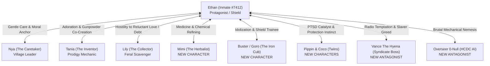

# Niiikotopia: Human — Character Bibles & Dramatis Personae

> **Document Type:** Character Bibles, Progressive Bios & Relationship Matrices  
> **Parent Document:** [Niiikotopia Human GDD.md](file:///Users/taniafelidae/ETStudio/ETWorldDesigner/GameDesigner/PC%20Game/Niiikotopia%20Human/Niiikotopia%20Human%20GDD.md)  
> **Related Documents:**  
> - [Niiikotopia Human Plot.md](file:///Users/taniafelidae/ETStudio/ETWorldDesigner/GameDesigner/PC%20Game/Niiikotopia%20Human/Niiikotopia%20Human%20Plot.md)  
> - [Niiikotopia Human Gameplay.md](file:///Users/taniafelidae/ETStudio/ETWorldDesigner/GameDesigner/PC%20Game/Niiikotopia%20Human/Niiikotopia%20Human%20Gameplay.md)  
> - [Niiikotopia Human World & Lore.md](file:///Users/taniafelidae/ETStudio/ETWorldDesigner/GameDesigner/PC%20Game/Niiikotopia%20Human/Niiikotopia%20Human%20World%20%26%20Lore.md)  
> - Reference: [Niiikotopia Human Raw Design.md](file:///Users/taniafelidae/ETStudio/ETWorldDesigner/GameDesigner/PC%20Game/Niiikotopia%20Human/Niiikotopia%20Human%20Raw%20Design.md)

---

## 1. Character Relationship & Dynamic Matrix

---

## 2. The Primary Cast

### Ethan (Inmate #7412)
- **Role:** Protagonist / Disgraced Convict / The Living Shield
- **Physical Profile:** Age 46 | Height: 1.88m (6'2") | Weight: 95 kg | Heavy build, graying dark hair, scarred face, collar barcode burn-scar on left neck.
- **Voice Archetype:** Deep, gravelly, exhausted bass; speaks in short, clipped sentences conditioned by solitary confinement.
- **Signature Behavior:** Methodically wipes down mechanical tools; glances nervously at doorways; unconsciously ruffles Niiiko ears when lost in thought.
- **Progression Bio:**
  - *Act 1:* An escaped convict seeking to repair his ship and auction off the village to buy a clean ID card.
  - *Act 3:* Haunted by the transport crash that killed children twenty years ago, he uses his massive strength to do heavy labor for the village.
  - *Act 6:* Refuses to abandon the village, enduring shattered collarbones from firing Tania's bone-breaker rifle.
  - *Epilogue:* Throws Tania and Lily into his shuttle, sacrifices himself to destroy the corporate AA battery, and dies a real human.

---

### Nya (Formerly Tonicat, The Enchanter / The Caretaker)
- **Role:** Village Leader & Head Researcher
- **Physical Profile:** Age ~20 (Niiiko maturity) | Height: 1.20m | Weight: 24 kg | Cream-white fur, gentle amber eyes, wears an oversized human lab coat.
- **Base Attributes:** Cuteness: 100/100 | Physical Power: 2/100 | Magic Power: 2/100
- **Signature Quote:** *"Hmmm, what should I eat today?"*
- **Role in Story:**
  - Welcomes Ethan with hand-drawn charcoal boards and warm root soup instead of terror.
  - Translates colonial books left behind in Sector-04.
  - Commands the evacuation Ark, piloting 10,000 Niiikos into the stars during the final siege.

---

### Tania, The Inventor
- **Role:** Chief Mechanic & Transmutation Prodigy
- **Physical Profile:** Age ~18 | Height: 1.18m | Weight: 22 kg | Calico fur, cybernetic antenna array welded to her left ear, grease smudges on her nose.
- **Base Attributes:** Cuteness: 90/100 | Physical Power: 1/100 | Magic Power: 5/100 (Class: Transmutation)
- **Signature Quote:** *"Waaaa Where did I put my X element!"*
- **Role in Story:**
  - Fixes Ethan’s shuttle engine; looks at Ethan with pure, uncritical wonder.
  - Invents black gunpowder and crafts the heavy scrap-iron kinetic rifle.
  - Offers to sacrifice herself at the AA battery, but is thrown into Ethan's escaping shuttle alongside Lily, surviving into the world of *Forever Alone*.

---

### Lily, The Collector
- **Role:** Feral Scavenger & Village Watchdog
- **Physical Profile:** Age ~19 | Height: 1.21m | Weight: 25 kg | Dark charcoal fur, notched right ear, bandaged knuckles, carries crude scrap knives.
- **Base Attributes:** Cuteness: 90/100 | Physical Power: 10/100 | Magic Power: 2/100 (Class: Steal, Mischief)
- **Signature Quote:** *"Ehh what did you say?"*
- **Role in Story:**
  - Smells the prison stench on Ethan and tries to poison his food in Act 3.
  - Deeply jealous of other Niiikos receiving Ethan’s headpats.
  - Becomes Ethan's scouting partner during cavern supply runs.
  - When locked into the shuttle by Ethan, she screams and beats the glass in tears, vowing to drag him out of hell just to feel his hand on her ears.

---

## 3. New Characters (Expanded Cast)

### 🌿 Mimi, The Herbalist & Pharmacist *(NEW CHARACTER)*
- **Role:** Village Botanist, Medical Caregiver & Chemical Refiner
- **Physical Profile:** Age ~21 | Height: 1.19m | Weight: 23 kg | Soft silver-gray fur, small round wire-rim spectacles salvaged from a colonial locker, floral apron stained with purple sap.
- **Base Attributes:** Cuteness: 95/100 | Physical Power: 3/100 | Magic Power: 4/100 (Class: Botany & Bio-Catalysis)
- **Signature Quote:** *"Please hold still, Mr. Giant... this moss will sting, but your bone will knit."*
- **Favorite Activity:** Cultivating bioluminescent cave fungi; drying wild mint and chamomile on hanging hemp racks; cataloging medicinal flora.
- **Favorite Food:** Steamed honey-glazed sweet tubers and cold spring water.
- **Narrative & Gameplay Role:**
  - **The Healer:** Treats Ethan's cracked ribs and fractured collarbone after he tests Tania's brutal kinetic rifle. Her gentle bedside conversations reveal the calm, domestic heart of the village.
  - **Gunpowder Refining:** Mimi provides the purified sulfur and potassium nitrate (refined from bat guano and fungal saltbeds) that Tania needs to mix functional gunpowder.
  - **Gameplay Mechanic:** Ethan visits Mimi's hut to craft **Analgesic Salves** (reduces aim tremor from broken bones) and **Stun-Neutralizing Herbal Broth**.

---

### 🛡️ Buster / Goro, The Iron Cub *(NEW CHARACTER)*
- **Role:** Aspiring Village Guardian & Shield Apprentice
- **Physical Profile:** Age ~15 (adolescent Niiiko) | Height: 1.25m | Weight: 30 kg | Stocky brown tabby fur, floppy ears, thick paws, wears an oversized leather welder’s vest.
- **Base Attributes:** Cuteness: 85/100 | Physical Power: 15/100 | Magic Power: 1/100 (Class: Physical Guard)
- **Signature Quote:** *"I'm big too! I can take a hit, Mr. Ethan!"*
- **Favorite Activity:** Carrying a heavy rusted landing-gear panel as a riot shield; following Ethan and attempting to walk with the same heavy, rhythmic stomp.
- **Favorite Food:** Smoked river fish and crunchy dried beetles.
- **Narrative & Gameplay Role:**
  - **Ethan’s Shadow:** Buster looks up to Ethan not as a monster or an alien, but as a mythical "Titan Brother." He clumsily salutes Ethan every morning.
  - **The Crucible of Innocence:** During the first harvester drop, Buster positions himself with his scrap plate between an unconscious child and a stun drone. He is blasted backwards and paralyzed. Ethan roars in blind fury and dives into the line of fire to rescue Buster, cementing Ethan’s transformation into the village’s guardian.
  - **Gameplay Mechanic:** Buster acts as a companion in defensive barricade sections, holding portable cover panels that Ethan can shoot over.

---

### 🐾 Pippin & Coco (The Orphan Twins #0912 & #0913) *(NEW CHARACTERS)*
- **Role:** Toddler Hatchlings & Living Catalysts of Guilt
- **Physical Profile:** Age ~4 | Height: 0.95m | Weight: 14 kg each | Golden-striped calico twins, oversized floppy ears, wearing faded nursery smocks with plastic barcodes `#0912` and `#0913`.
- **Base Attributes:** Cuteness: 100/100 | Physical Power: 1/100 | Magic Power: 1/100
- **Signature Behavior:** Sneaking into Ethan's shuttle cockpit to touch shiny buttons; curling up together inside Ethan’s combat boots while he sleeps.
- **Favorite Food:** Sweet berry mash smeared over crispy seed crackers.
- **Narrative Role:**
  - **The PTSD Anchor:** Whenever Ethan looks at Pippin and Coco, auditory flashbacks of the transport disaster flare in his mind. Their giggles directly trigger his memory of the burning hab-block children.
  - **Emotional Climax:** In Act 4, when the harvesters drop stun nets, Pippin and Coco are trapped in the open square. Ethan abandons his shuttle ramp and charges through electric barrages to shield the twins with his own back.

---

### 🐺 Vance "The Hyena" (Underworld Syndicate Boss) *(NEW ANTAGONIST)*
- **Role:** Radio Antagonist / Mad Dog Gang Kingpin
- **Physical Profile:** Human | Age 58 | Harsh cybernetic vocal synthesizer; communicates via subspace audio on Ethan's cockpit console.
- **Personality:** Cynical, transactional, utterly unbothered by cruelty; views all organic life as slaughterhouse assets.
- **Signature Quote:** *"Twenty years in a hole and you grew a conscience, #7412? Don't make me laugh. Send the coordinates and I'll make you a citizen."*
- **Narrative Role:**
  - **The Voice of Ethan's Past:** Serves as the devil whispering in Ethan's ear through the first four acts. Every conversation with Vance reminds the player of the alternative path: sell the 10,000 Niiikos, become rich, and live out retirement in a luxury spire.
  - When Ethan ultimately smashes the subspace radio with his rifle butt in Act 5, it signifies his absolute moral break from his criminal life.

---

### 🤖 Overseer 0-Null / Unit Harvest-Prime *(NEW ANTAGONIST)*
- **Role:** Automated HCDC Harvesting Fleet Commander
- **Entity Type:** Corporate Logistics AI operating from the flagship in high orbit.
- **Voice Profile:** Polished, sterile, cheerful female customer-service synthesizer echoing through drone PA horns and drop-ship loudspeakers.
- **Signature Broadcast:** *"Valued biological specimens: Please refrain from aggressive kinetics. Stun pulses are non-lethal and calibrated for optimal market grading. Compliance ensures painless crating."*
- **Narrative Role:**
  - Employs the terrifying banality of corporate evil. It does not hate the Niiikos; it views them as grain waiting for a combine harvester.
  - Serves as the thematic counterweight to Ethan's journey: Bio-Corp represents the legal, civilized "humans" who act like emotionless butchers, while Ethan—the subhuman convict—acts with genuine love and honor.
