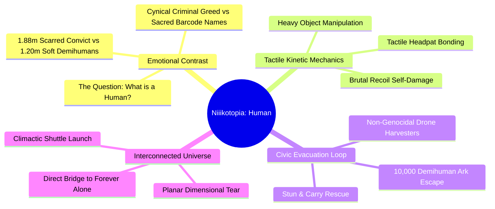

# Niiikotopia: Human — Master Game Design Document (GDD)

> **Project Title:** Niiikotopia: Human  
> **Genre:** Third-Person Narrative Action-Adventure / Survival Puzzle & Siege Defense  
> **Platform:** PC (Steam / Epic Games Store), PlayStation 5, Xbox Series X|S  
> **Engine:** Unreal Engine 5 / Unity 6  
> **Target Audience:** Fans of mature, emotionally resonant sci-fi narratives (*The Last of Us*, *NieR: Automata*, *A Plague Tale*, *Shadow of the Colossus*) and cinematic indie games.  
> **Author & Studio:** ET Studio / 2026  
> **Source Material:** Preserved in [Niiikotopia Human Raw Design.md](file:///Users/taniafelidae/ETStudio/ETWorldDesigner/GameDesigner/PC%20Game/Niiikotopia%20Human/Niiikotopia%20Human%20Raw%20Design.md)

---

## 1. Executive Summary & Product Vision

### 1.1 One-Line Hook
*A broken convict crash-lands on an innocent demihuman breeding sanctuary to sell them for his legal freedom—only to shatter his own bones shielding them from automated corporate harvesters.*

### 1.2 The High Concept
**Niiikotopia: Human** is a cinematic, story-driven 3D action-adventure exploring the philosophical definition of humanity. Players control **Ethan (Inmate #7412)**, an escaped colonial convict who lands on an unmapped sanctuary populated by 10,000 delicate, 1.2m tall cat-eared demihumans (Niiikos). 

Initially planning to sell the village to criminal slavers to buy a forged citizen ID, Ethan's twenty years of cynical prison conditioning disintegrate under the unconditional warmth and trust of the villagers. When an automated corporate fleet darkens the sky to harvest the Niiikos as livestock, Ethan turns his giant frame into an immovable shield—trading his legal ticket home so the species can escape into the stars.

---

## 2. Master Document Index & Navigation

To maintain clean modularity across the design bible, this GDD links directly to comprehensive sub-documents:

| Document | Primary Focus | Direct Link |
| :--- | :--- | :--- |
| **Narrative Bible** | Complete 7-Act Script breakdown, scene-by-scene scenarios, dialogue motifs, and moral dilemmas. | **[Niiikotopia Human Plot.md](file:///Users/taniafelidae/ETStudio/ETWorldDesigner/GameDesigner/PC%20Game/Niiikotopia%20Human/Niiikotopia%20Human%20Plot.md)** |
| **Systems & Mechanics** | Scale disparity, heavy carrying, tactile headpats, pneumatic launchers, bone-breaker recoil physics, and drone ecology. | **[Niiikotopia Human Gameplay.md](file:///Users/taniafelidae/ETStudio/ETWorldDesigner/GameDesigner/PC%20Game/Niiikotopia%20Human/Niiikotopia%20Human%20Gameplay.md)** |
| **Character Bibles** | In-depth profiles of Ethan, Nya, Tania, Lily, and **5 Brand New Characters** (Mimi, Buster, Pippin & Coco, Vance, Overseer 0-Null). | **[Niiikotopia Human Characters.md](file:///Users/taniafelidae/ETStudio/ETWorldDesigner/GameDesigner/PC%20Game/Niiikotopia%20Human/Niiikotopia%20Human%20Characters.md)** |
| **World Lore & Codex** | Bio-Corp lore, Tartarus-9, Sector-04 Sanctuary, Plastic Name Tag culture, and the dimensional bridge into *Forever Alone*. | **[Niiikotopia Human World & Lore.md](file:///Users/taniafelidae/ETStudio/ETWorldDesigner/GameDesigner/PC%20Game/Niiikotopia%20Human/Niiikotopia%20Human%20World%20%26%20Lore.md)** |
| **Shared Universe** | The companion psychological horror game whose suburban garden receives the crashed shuttle in the epilogue. | **[Forever Alone.md](file:///Users/taniafelidae/ETStudio/ETWorldDesigner/GameDesigner/PC%20Game/Forever%20Alone.md)** |
| **Raw Design Archive** | Unaltered original design notes and reference specs. | **[Niiikotopia Human Raw Design.md](file:///Users/taniafelidae/ETStudio/ETWorldDesigner/GameDesigner/PC%20Game/Niiikotopia%20Human/Niiikotopia%20Human%20Raw%20Design.md)** |

---

## 3. Core Pillars & Unique Selling Points (USPs)

1. **The Extreme Scale & Vulnerability Disparity:**
   - Ethan’s 1.88m, 95kg battle-scarred frame tower over the fragile 1.2m Niiikos. The physical contrast reinforces the player's role not just as a fighter, but as a living physical wall protecting toddlers from industrial machinery.
2. **Visceral Recoil Physics & Weapon Weight:**
   - Gunplay is rare, heavy, and consequential. Tania’s scrap-iron rifle fires with such violent kinetic impulse that it pushes Ethan back in the mud, shatters his collarbone over time, and requires manual bolt racking and physical bracing.
3. **The Inverse Definition of "Human":**
   - The game flips traditional tropes: the legal, clean, civilized human conglomerate acts like sterile, emotionless slaughterhouse harvesters, while the degraded subhuman convict and the lab-grown "livestock" discover genuine love, empathy, and sacrifice.
4. **Cinematic Cross-Game Universe Bridge:**
   - The climactic act directly bridges into **[Forever Alone](file:///Users/taniafelidae/ETStudio/ETWorldDesigner/GameDesigner/PC%20Game/Forever%20Alone.md)**, revealing how Tania and Lily’s damaged shuttle crash-lands in Mai's foggy backyard garden.

---

## 4. Dramatis Personae (Character Overview)

Full bios, progression stages, and relationship matrices are detailed in **[Niiikotopia Human Characters.md](file:///Users/taniafelidae/ETStudio/ETWorldDesigner/GameDesigner/PC%20Game/Niiikotopia%20Human/Niiikotopia%20Human%20Characters.md)**.

### The Original Cast
- **[Ethan (Inmate #7412)](file:///Users/taniafelidae/ETStudio/ETWorldDesigner/GameDesigner/PC%20Game/Niiikotopia%20Human/Niiikotopia%20Human%20Characters.md#ethan-inmate-7412):** Aging convict seeking to buy back his citizenship; becomes the sacrificial shield of Sector-04.
- **[Nya (The Caretaker)](file:///Users/taniafelidae/ETStudio/ETWorldDesigner/GameDesigner/PC%20Game/Niiikotopia%20Human/Niiikotopia%20Human%20Characters.md#nya-formerly-tonicat-the-enchanter--the-caretaker):** Gentle researcher in an oversized lab coat who communicates via charcoal sketches and pilots the Ark.
- **[Tania (The Inventor)](file:///Users/taniafelidae/ETStudio/ETWorldDesigner/GameDesigner/PC%20Game/Niiikotopia%20Human/Niiikotopia%20Human%20Characters.md#tania-the-inventor):** Cybernetic-geared transmutation prodigy who creates gunpowder and crafts the heavy kinetic rifle.
- **[Lily (The Collector)](file:///Users/taniafelidae/ETStudio/ETWorldDesigner/GameDesigner/PC%20Game/Niiikotopia%20Human/Niiikotopia%20Human%20Characters.md#lily-the-collector):** Feral scavenger who hates Ethan’s criminal stench, secretly yearns for his touch, and is forced into the escaping shuttle.

### The New Characters
- **[Mimi, The Herbalist & Pharmacist](file:///Users/taniafelidae/ETStudio/ETWorldDesigner/GameDesigner/PC%20Game/Niiikotopia%20Human/Niiikotopia%20Human%20Characters.md#-mimi-the-herbalist--pharmacist-new-character):** *New Village Character.* The soft-spoken botanist who refines sulfur and potassium nitrate for Tania's gunpowder, treats Ethan's fractured ribs, and brews pain-relieving poultices.
- **[Buster / Goro, The Iron Cub](file:///Users/taniafelidae/ETStudio/ETWorldDesigner/GameDesigner/PC%20Game/Niiikotopia%20Human/Niiikotopia%20Human%20Characters.md#-buster--goro-the-iron-cub-new-character):** *New Village Character.* A brave, stocky adolescent Niiiko who carries a rusted landing gear plate as a shield, idolizes Ethan as a giant brother, and provides mobile cover in trench battles.
- **[Pippin & Coco (Twins #0912 & #0913)](file:///Users/taniafelidae/ETStudio/ETWorldDesigner/GameDesigner/PC%20Game/Niiikotopia%20Human/Niiikotopia%20Human%20Characters.md#-pippin--coco-the-orphan-twins-0912--0913-new-characters):** *New Village Characters.* Two kitten toddlers who climb into Ethan's combat boots, triggering his PTSD flashbacks of the colonial children he failed to save twenty years ago.
- **[Vance "The Hyena"](file:///Users/taniafelidae/ETStudio/ETWorldDesigner/GameDesigner/PC%20Game/Niiikotopia%20Human/Niiikotopia%20Human%20Characters.md#-vance-the-hyena-underworld-syndicate-boss-new-antagonist):** *New Antagonist.* Slaver syndicate boss on the cockpit subspace radio, tempting Ethan with fake citizen passports in exchange for Sector-04’s coordinates.
- **[Overseer 0-Null / Unit Harvest-Prime](file:///Users/taniafelidae/ETStudio/ETWorldDesigner/GameDesigner/PC%20Game/Niiikotopia%20Human/Niiikotopia%20Human%20Characters.md#-overseer-0-null--unit-harvest-prime-new-antagonist):** *New Antagonist.* The polite, cheerful automated corporate AI directing the drone harvesting fleet, treating 10,000 living creatures as livestock inventory.

---

## 5. Visual Art Direction & Audio Design

### 5.1 Visual Direction: Stylized Physical Realism
- **Visual Contrast:**
  - **The Human / Corporate Sphere:** Heavy, rusted, brutalist industrial metal; chipped gray paint, hydraulic oil leaks, harsh blinding searchlights, and cold holographic HUDs.
  - **The Niiiko Sphere:** Soft, vibrant, hand-crafted pastoral warmth; wooden huts woven with bioluminescent moss, oversized hand-me-down lab coats, warm glowing lantern fires, and soft fur shaders with dynamic squash-and-stretch.
- **Lighting & Palette:**
  - *Acts 1–3:* Golden-hour autumnal forest sunlight, soft fog, firefly glows (peaceful domesticity).
  - *Acts 4–7:* Thunderstorm dusk; harsh blinding white corporate drone spotlights piercing black smoke and churning mud trenches.

### 5.2 Audio Landscape
- **Score:** Low cello and mourning acoustic guitar reflecting Ethan’s weary solitude, intercut with playful woodwinds and acoustic marimbas during village interactions.
- **Combat Soundscapes:** The drone fleet attacks with cold, rhythmic industrial hums and polite synthetic announcements, punctuated by the cataclysmic, bass-heavy thunderclap of the Bone-Breaker rifle.

---

## 6. Technical Architecture & Production Scope

| System | Implementation Target | Specifications |
| :--- | :--- | :--- |
| **Physics & Recoil** | Custom Rigidbody & Impulse Solver | Procedural weapon kickback, camera shake trauma curves, physical knockback on character mesh. |
| **Crowd & AI Logic** | Hybrid Flocking & Task Agent System | Handles pathfinding and behavioral states for up to 100 active on-screen Niiikos and 40 harvesting drones simultaneously. |
| **Diegetic UI** | Zero Screen Clutter | Health indicated by Ethan's posture and heartbeat audio; ammo checked by looking at Ethan's bandolier. |
| **Target Runtime** | 10–14 Hours Campaign | Linear narrative progression across 7 distinct story acts with multiple environmental biomes. |

---

## 7. Next Steps & Implementation Roadmap

1. **Phase 1 (Milestone M1 - Prototype):** Implement Ethan's third-person movement, physical weight scaling, heavy carrying mechanics, and the basic headpat interaction.
2. **Phase 2 (Milestone M2 - Combat Vertical Slice):** Polish the Bone-Breaker rifle recoil impulse, pneumatic launcher, and collector drone stun-and-carry rescue loop.
3. **Phase 3 (Milestone M3 - Narrative & Level Flow):** Build out the 7 acts detailed in **[Niiikotopia Human Plot.md](file:///Users/taniafelidae/ETStudio/ETWorldDesigner/GameDesigner/PC%20Game/Niiikotopia%20Human/Niiikotopia%20Human%20Plot.md)**, integrating character dialogue, signboards, and cinematic cutscenes.
4. **Phase 4 (Milestone M4 - Polish & Cross-Game Integration):** Finalize the epilogue cinematic bridge linking into **[Forever Alone.md](file:///Users/taniafelidae/ETStudio/ETWorldDesigner/GameDesigner/PC%20Game/Forever%20Alone.md)**.
