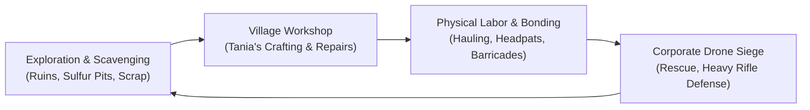
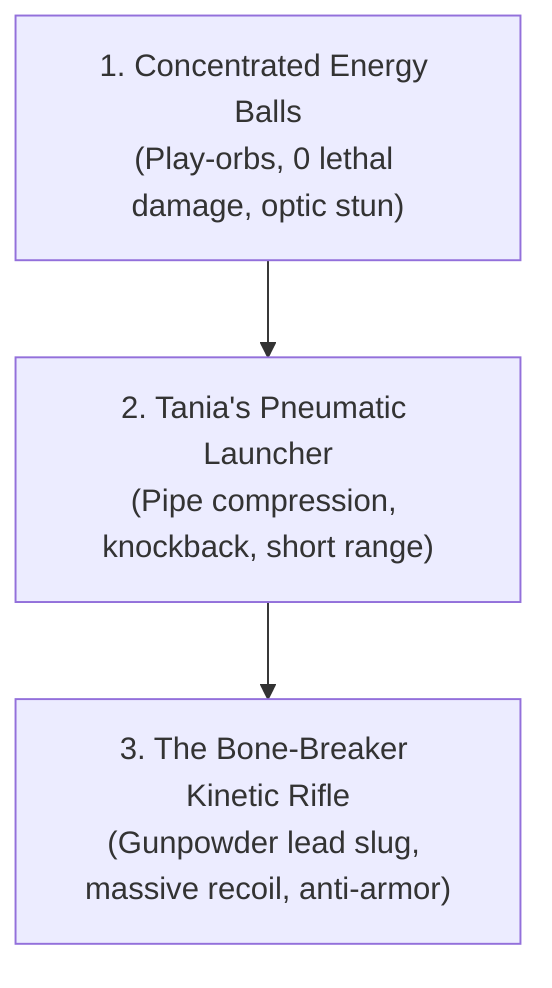

# Niiikotopia: Human — Gameplay Mechanics & Systems Design

> **Document Type:** Core Mechanics, Systems & Combat Design  
> **Parent Document:** [Niiikotopia Human GDD.md](file:///Users/taniafelidae/ETStudio/ETWorldDesigner/GameDesigner/PC%20Game/Niiikotopia%20Human/Niiikotopia%20Human%20GDD.md)  
> **Related Documents:**  
> - [Niiikotopia Human Plot.md](file:///Users/taniafelidae/ETStudio/ETWorldDesigner/GameDesigner/PC%20Game/Niiikotopia%20Human/Niiikotopia%20Human%20Plot.md)  
> - [Niiikotopia Human Characters.md](file:///Users/taniafelidae/ETStudio/ETWorldDesigner/GameDesigner/PC%20Game/Niiikotopia%20Human/Niiikotopia%20Human%20Characters.md)  
> - [Niiikotopia Human World & Lore.md](file:///Users/taniafelidae/ETStudio/ETWorldDesigner/GameDesigner/PC%20Game/Niiikotopia%20Human/Niiikotopia%20Human%20World%20%26%20Lore.md)  
> - Reference: [Niiikotopia Human Raw Design.md](file:///Users/taniafelidae/ETStudio/ETWorldDesigner/GameDesigner/PC%20Game/Niiikotopia%20Human/Niiikotopia%20Human%20Raw%20Design.md)

---

## 1. High-Level Game Loop & Progression Structure

The gameplay of **Niiikotopia: Human** blends tactile third-person survival-adventure, physical labor puzzles, and intense, visceral kinetic combat. The gameplay loop transitions dynamically across the narrative acts:

---

## 2. Character Physics & Physical Presence

### 2.1 The Giant Among Children (Physical Scale Disparity)
- **Scale Contrast:** Ethan stands **1.88 meters (6'2")** and weighs **95 kg**, contrasting sharply with the Niiikos who stand **1.18m–1.21m** and weigh **22–26 kg**.
- **Camera Perspective:** Over-the-shoulder third-person camera positioned at Ethan's chest height, making the surrounding environment and villagers feel fragile, low-to-the-ground, and vulnerable.
- **Physical Weight & Interaction:**
  - Ethan cannot crawl into tiny ventilation ducts or forest hollows where Niiikos easily slip.
  - Ethan can easily lift, push, and carry 150 kg engine blocks, fallen logs, and steel barricades that immobilize an entire squad of Niiikos.
  - When walking near Niiikos, footsteps shake ground dust subtly; Ethan must be mindful not to accidentally bump or stumble into them.

### 2.2 Physical Degradation & Health System
- **No Regenerating Health Bar:** Ethan’s vitality is tracked via **Trauma & Integrity**:
  - **Electric Stun Shock:** Absorbed from corporate drones. Causes Ethan's muscles to spasm, slows movement, and blurs vision.
  - **Recoil Bone-Stress:** Firing the heavy scrap rifle fractures Ethan’s shoulder and collarbone over time.
- **Visual & Audio Feedback:** As damage accumulates, Ethan limps heavily, breathes raggedly through his teeth, and screen edges bleed into a gritty desaturated red vignette.

---

## 3. The Core Interactive Mechanics

### 3.1 The "Headpat / Reassurance" System
- **Contextual Interaction Prompt (`[E]` / Right Trigger):**
  - When working alongside Niiikos or finishing a cooperative task, nearby Niiikos look up at Ethan with twitching ears.
  - Pressing the interaction key initiates a gentle, tactile headpat animation. Ethan's scarred, calloused hand rests atop their fuzzy ears.
- **Mechanical Effects:**
  - **Village Morale:** Increases local Niiiko movement and crafting speed by `+15%`.
  - **Lily's Hostility Meter:** Lily initially rejects headpats, hissing or slapping Ethan's wrist away. Over repeated acts of selflessness, her reaction transitions from hostility $\rightarrow$ suspicious glaring $\rightarrow$ reluctant tolerance $\rightarrow$ secret yearning.

### 3.2 Heavy Hauling & Environmental Puzzles
- **Two-Handed Carry Mode:**
  - When lifting reactor manifolds, steel sheets, or fallen beams, Ethan enters a heavy carrying state.
  - Movement speed is halved; weapon usage is disabled.
  - Stamina drains while sprinting with heavy loads. Niiikos can gather around the load to "help push," slightly reducing Ethan's stamina drain.

### 3.3 The Charcoal Signboard & Language Translation Mini-Game
- **Diegetic Communication:**
  - In Acts 1–2, before Ethan understands Niiiko vocal chirps, dialogue occurs through **Nya’s Charcoal Signboards**.
  - Players engage in an intuitive symbol-association interface: matching pictograms (a bed, a bowl, a broken gear, a skull) with Ethan's internal monologue thoughts to communicate intent.

---

## 4. The Arsenal Progression & Combat Design

Combat in **Niiikotopia: Human** progresses from non-lethal civilian toys to bone-shattering, improvised kinetic violence.

### 4.1 Concentrated Energy Balls
- **Lore Context:** Bioluminescent natural plasma harvested from local flora.
- **Weapon Mechanics:**
  - Thrown by hand in an arc.
  - Deals `0` physical damage to organic targets.
  - Stuns drone camera optics for `2.5 seconds`, allowing players to slip past searchlights.

### 4.2 Tania's Pneumatic Launcher ("The Whistle-Pipe")
- **Lore Context:** Improvised from high-pressure hydraulic pipes and copper valves.
- **Weapon Mechanics:**
  - Fires compressed metal scrap and dense plasma cores.
  - Effective range: `15–20 meters`.
  - High stagger force: knocks scout drones into trees and dents light armor.
  - Requires manual hand-pump reloading after every 3 shots.

### 4.3 The Scrap-Iron Gunpowder Rifle ("The Bone-Breaker")
- **Lore Context:** Forged by Tania from recycled landing gear struts and filled with crude charcoal/sulfur/saltpeter powder.
- **Weapon Mechanics:**
  - Single-shot bolt-action firearm firing 20mm lead slugs.
  - **Devastating Anti-Armor Power:** Tears through corporate drop-ship plates and obliterates collector drones in a single center-mass shot.
  - **Brutal Recoil Physics:**
    - Firing unleashes an explosive audio boom that echoes across the entire valley.
    - Physical impulse kicks Ethan back by `0.8 meters`.
    - Crosshair jumps violently into the ceiling; Ethan must manually rack the smoking bolt (`[R]`).
    - **Self-Damage Mechanic:** Continuous firing without bracing against a bunker wall deals small increments of internal trauma to Ethan’s collarbone.

---

## 5. Enemy Types & Corporate Harvester Tactics

The **Human Colony Defense Corporation (HCDC)** operates not as an army seeking genocide, but as an **automated livestock collection team**. Their protocols are optimized for **zero-bruise commodity preservation**.

| Enemy Unit | Chassis Type | Combat Protocol | Player Countermeasure |
| :--- | :--- | :--- | :--- |
| **Collector Drone** | Light Quadcopter | Fires bio-electric stun orbs that paralyze Niiikos in 1 hit and slow Ethan. | Stun with Energy Balls, shoot down with Pneumatic Launcher, or swat down with two-by-four planks. |
| **Stalker Drone** | Bipedal Scout | Deploys optical cloaking; stalks Ethan in dark caverns; marks targets with laser painting. | Listen for servo whirrs; utilize Lily's alert calls to flank and crush with melee attacks. |
| **Vacuum Harvester** | Heavy Quadruped | Deploys electrified tether cables and pneumatic vacuum tubes to suck paralyzed Niiikos into transport pods. | Destroy leg joints with Bone-Breaker rifle; sever capture cables before transport pods fill. |
| **Drop-Ship Pod** | Armored Atmospheric Carrier | Descends from cloud cover, disgorging fresh waves of collector drones and reinforcing harvesters. | Target thruster pods during descent with explosive gunpowder charges. |
| **The Orbital AA Battery** | Emplaced Super-Turret | Automated twin-railgun array that locks onto atmospheric vessels breaching 5,000 feet. | Infiltration / Suicidal charge across open trenches; target targeting servos at point-blank range. |

---

## 6. The Rescue & Evacuation Loop (The Ark Defense)

During Acts 5–7, combat is defined not just by killing enemies, but by **saving lives under active harvest**:

1. **The Stun-and-Carry Mechanic:**
   - When a Niiiko is hit by a stun orb, they fall limp with a `60-second` capture timer counting down above them.
   - Collector drones and vacuum spiders will path directly toward stunned villagers.
   - Ethan must sprint into incoming fire, physically scoop the unconscious Niiiko onto his shoulder, and carry them to the safety of the underground bunker before the harvester tethers them.
2. **The Ark Construction Barricade:**
   - Players allocate scavenged metals and fuel canisters to Tania’s engineering team.
   - Fortifying the launch silo gates reduces drone breach rates, giving Nya the critical time needed to spin up the Ark’s atmospheric thrusters.
