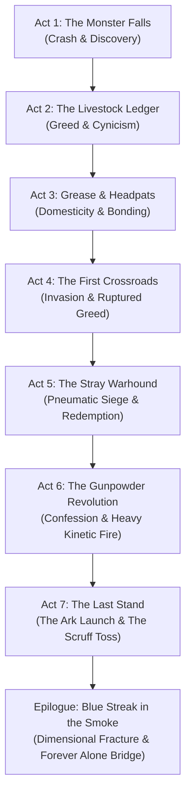

# Niiikotopia: Human — Narrative & Plot Design

> **Document Type:** Narrative Design Bible & Scenario Script  
> **Parent Document:** [Niiikotopia Human GDD.md](file:///Users/taniafelidae/ETStudio/ETWorldDesigner/GameDesigner/PC%20Game/Niiikotopia%20Human/Niiikotopia%20Human%20GDD.md)  
> **Related Documents:**  
> - [Niiikotopia Human Characters.md](file:///Users/taniafelidae/ETStudio/ETWorldDesigner/GameDesigner/PC%20Game/Niiikotopia%20Human/Niiikotopia%20Human%20Characters.md)  
> - [Niiikotopia Human Gameplay.md](file:///Users/taniafelidae/ETStudio/ETWorldDesigner/GameDesigner/PC%20Game/Niiikotopia%20Human/Niiikotopia%20Human%20Gameplay.md)  
> - [Niiikotopia Human World & Lore.md](file:///Users/taniafelidae/ETStudio/ETWorldDesigner/GameDesigner/PC%20Game/Niiikotopia%20Human/Niiikotopia%20Human%20World%20%26%20Lore.md)  
> - Reference: [Niiikotopia Human Raw Design.md](file:///Users/taniafelidae/ETStudio/ETWorldDesigner/GameDesigner/PC%20Game/Niiikotopia%20Human/Niiikotopia%20Human%20Raw%20Design.md)

---

## 1. The Core Narrative Premise & Themes

### 1.1 The Central Question: *"What is a Human?"*
In the 26th Century, humanity has defined itself through corporate legal status. Under colonial governance, a "human" is not a biological entity; a human is a licensed citizen possessing a valid biometric ID chip, tax registration, and colonial protection. Convicts who commit grave offenses are stripped of this status under the *Penal Reclamation Act*, their chips vaporized, their bodies reclassified as "Subhuman Industrial Assets."

Ethan, Inmate #7412, spent twenty years in deep-space chains believing that regaining his legal card was the only way to become human again. When he crash-lands on Sanctuary Sector-04, he finds 10,000 cat-eared demihumans (Niiikos) who wear corporate livestock barcodes around their necks—yet treat those tags as sacred names of love, family, and personhood.

The story charts the inverse arc of humanity: **A legal monster who learns to be a soul, and an innocent species that teaches a convict how to die with dignity.**

---

## 2. Narrative Arc & Seven-Act Master Structure

---

### Act 1: The Monster Falls (The Crash & Discovery)

#### Scene 1.1 — *Inmate #7412*
- **Setting:** Orbit of Tartarus-9 / Stolen Rogue Shuttle Cockpit.
- **Narrative Beat:** Klaxons roar as emergency thrusters sputter. Through broken viewport glass, burning stellar debris reflects in Ethan's deadened eyes. A twenty-year flashback flashes across his retinas: screaming sirens, twisted colonial hab-block girders, and the blackened remains of children killed by his overloaded cargo skiff. Ethan mutters his single prayer: *"Just give me a card. Just give me my name back."*
- **Climax of Scene:** The hyperdrive core ruptures, dumping the shuttle out of slipspace into an unmapped atmosphere. The terrain rushes upward in fire.

#### Scene 1.2 — *Dead Metal*
- **Setting:** Sector-04 Forest Canopy / Smoking Crash Crater.
- **Narrative Beat:** Ethan drags his 1.88m battered frame out of the cockpit onto the wet moss. His standard-issue stun pistol clicks empty (0 ammo). His leg is lacerated. Through the rising steam, pairs of glowing feline eyes emerge from the ferns. Small, 1.2m tall figures in crude linen lab-tunics surround him in total silence.
- **Climax of Scene:** Ethan raises his fists, expecting alien predators. Instead, he sees soft fur, twitching ears, and numbered plastic tags around their necks.

#### Scene 1.3 — *The Stun Barrage*
- **Setting:** Crash Clearing.
- **Narrative Beat:** Paralyzed by prison conditioning, Ethan grabs the nearest small figure by the wrist. Instantly, thirty Niiikos pelt him with glowing, bioluminescent plasma spheres. The impacts tickle and glow harmlessly like soft rubber balls. Ethan stumbles back, realizing they have no weapons and no malice.

#### Scene 1.4 — *The Girl in the Coat*
- **Setting:** Edge of the Forest Trail.
- **Narrative Beat:** The crowd parts. A small Niiiko wearing an adult human lab coat with sleeves dragged through mud steps forward. It is **Nya**. She holds up a slab of charred wood with a crude charcoal drawing of a steaming bowl and a bed. She tilts her head and chirps softly. Ethan collapses from blood loss.

---

### Act 2: The Livestock Ledger (Greed & Calculation)

#### Scene 2.1 — *Charcoal & Broth*
- **Setting:** Nya's Communal Hut.
- **Narrative Beat:** Ethan wakes to the smell of wild vegetable broth. Nya sits beside him, patiently drawing symbols on boards. She points to her chest: *"Nya."* She points to him: he grunts *"Ethan."* When Ethan inspects her plastic collar tag (`SPECIMEN-CAT-0012-NYA`), the truth hits him like an electric baton: **This entire planet is an abandoned corporate bio-farm.**

#### Scene 2.2 — *Black Market Math*
- **Setting:** Village Center & Sacred Tree.
- **Narrative Beat:** Walking through the settlement, Ethan observes 10,000 Niiikos living in peaceful harmony. In his head, he calculates the underworld rate: $50,000$ credits per live specimen to colonial genetic labs; millions for the whole population. If he can get his shuttle transmitter fixed, his old syndicate boss, **Vance "The Hyena"**, will give him a forged citizen passport and an estate on the pleasure worlds.

#### Scene 2.3 — *The Spark & The Blade*
- **Setting:** Salvage Workshop & Scrap Grotto.
- **Narrative Beat:** Nya introduces Ethan to **Tania**, a frantic mechanic with cybernetic antenna gear welded to her skull, and **Lily**, a wild forest scavenger covered in scratches. Tania gasps with pure joy at Ethan’s shuttle engine schematics, agreeing to fix the core. Lily, however, bares her fangs, sniffing the foul chemical stink of prison sludge on Ethan's coat. She whispers to Tania: *"He is a wolf. Cut his throat while he sleeps."*

---

### Act 3: Grease and Headpats (Domesticity & Guilt)

#### Scene 3.1 — *Heavy Lifting*
- **Setting:** Riverbank Scrap Depot.
- **Narrative Beat:** Ethan spends days performing brute physical labor that no 1.2m Niiiko can accomplish—hauling titanium manifolds from the riverbed and hoisting reactor plates into the workshop. Whenever a task is done, the helpful young Niiikos line up around him, waiting. Clueless, Ethan casually pats their heads with his rough, grease-stained palm. The Niiikos purr loudly in delight. In the distance, Lily watches from a high branch, her tail lashing in quiet, envious fury.

#### Scene 3.2 — *Bitter Roots & Poisoned Soup*
- **Setting:** Campfire outside Ethan’s Shuttle.
- **Narrative Beat:** Lily sneaks wild paralyzing nightshade roots into Ethan's ration bowl. Ethan notices the strange purple glaze on the leaves. Without shouting or striking her, he simply tips the bowl into the fire, looks her dead in the eye, and says: *"Prison poison tasted like battery acid, kid. You need more practice."* Lily glares, conflicted and humiliated.

#### Scene 3.3 — *What is a Human?*
- **Setting:** Shuttle Hull under Starlight.
- **Narrative Beat:** Late at night, Tania sits atop the ship's wing with Ethan while soldering fiber lines. She looks at his giant hands and asks: *"Ethan... what is a Human? Nya says humans built the stars. Are they all like you?"* Ethan stares at his scarred knuckles. *"Humans are monsters who lock each other in iron cages and burn kids when they're in a hurry. You don't want to meet them."* Tania rests her forehead against his arm: *"You didn't burn us."*

---

### Act 4: The First Crossroads (The Iron Sky)

#### Scene 4.1 — *Green Light on the Dash*
- **Setting:** Shuttle Cockpit.
- **Narrative Beat:** Tania reconnects the final fuel cell. The avionics board glows amber, then steady green. The hyperdrive is ready for a single jump. Vance’s old sub-space frequency blinks on the communication array. Ethan’s thumb hovers over the send button. His freedom is right here.

#### Scene 4.2 — *The Sky Turns Iron*
- **Setting:** Village Sky & Perimeter.
- **Narrative Beat:** The sky splits with a deafening metallic screech. Giant corporate Drop-Harvesters from the **Human Colony Defense Corporation (HCDC)** descend through the clouds. Automated drone swarms launch, saturating the village with high-voltage stun nets and paralysis orbs. Niiikos drop like severed stalks of wheat.

#### Scene 4.3 — *Selfish Cargo*
- **Setting:** Shuttle Boarding Ramp.
- **Narrative Beat:** Ethan panics. He grabs Tania by her tunic collar and drags Lily kicking and screaming toward his shuttle: *"Get in! If we leave now, I can keep the two of you safe!"* But through the smoke, he sees Nya standing in front of the nursery hut, spreading her thin arms to protect unconscious toddlers as a spider-legged harvester stomps toward her. Ethan freezes. Twenty years of prison discipline shatter.

---

### Act 5: The Stray Warhound (The Pneumatic Siege)

#### Scene 5.1 — *No More Burning Kids*
- **Setting:** Village Barricade.
- **Narrative Beat:** The memory of the 20-year-old transport disaster surges into Ethan's ears as a deafening roar. Screaming in raw fury, he drops the shuttle access keys, grabs Tania’s crude pneumatic pipe launcher, and sprints directly into the stun fire.

#### Scene 5.2 — *Interception & Flesh Shields*
- **Setting:** Burning Village Alleyways.
- **Narrative Beat:** Ethan turns his massive body into a living barricade. Drones fire stun rounds that would stop a Niiiko's tiny heart; Ethan's hardened, scar-tissue-laden frame absorbs the electric shocks. Roaring in pain, he carries paralyzed villagers three at a time into the reinforced root cellars while firing pressurized scrap metal to smash drone sensory domes.

#### Scene 5.3 — *The Ark Blueprint*
- **Setting:** Subterranean Colony Vault.
- **Narrative Beat:** Nya and Tania lead Ethan into an ancient excavation site beneath the village: the half-buried hull of an old colonial evacuation transport (*The Ark*). Tania reveals that with her transmutation skills and the village's energy crystals, she can lift the entire population into orbit—but they need three days of fuel refinement and an iron wall on the surface.

---

### Act 6: The Gunpowder Revolution (Truth & Heavy Iron)

#### Scene 6.1 — *Sulfur, Saltpeter and Lily*
- **Setting:** Deep Caverns & Industrial Ruins.
- **Narrative Beat:** Ethan and Lily descend into the sulfur pits to scavenge chemical oxidizers. When a stalker drone ambushes them, Lily dives to intercept it, slashing its optic cables, while Ethan crushes its chassis beneath his boot. For the first time, Lily offers her hand to help him up.

#### Scene 6.2 — *The Kickback (The Bone-Breaker)*
- **Setting:** Tania's Underground Forge.
- **Narrative Beat:** Tania discovers the formula for ancient black gunpowder. She forges a monster: a solid scrap-iron kinetic rifle firing lead slugs. She tests it on a target; the recoil flips her across the room and dislocates her wrist. Ethan picks up the weapon. He chambers a hand-packed shell, aims, and fires. The blast shatters a stone boulder fifty meters away. Ethan’s shoulder snaps with a sickening crunch. He grimaces, resets his shoulder against a pillar, and smiles: *"Make fifty shells. Now."*

#### Scene 6.3 — *Truth in the Muddy Trench*
- **Setting:** Surface Barricade at Midnight.
- **Narrative Beat:** In the quiet between drone waves, Ethan sits in the muddy trench bandaging his bleeding collarbone. He looks at Tania and Lily and confesses the truth: *"When I landed here, I didn't see people. I saw livestock. I was going to sell every one of you to Vance for a plastic passport."* Lily draws her scrap knife, trembling with fury. But Tania puts her hand over Lily's blade: *"You could have left on Tuesday, Ethan. You're still here."*

---

### Act 7: The Last Stand (Sacrifice & Hyperspace)

#### Scene 7.1 — *The Ark Rises*
- **Setting:** Launch Silo Ridge.
- **Narrative Beat:** All 10,000 Niiikos are sealed inside the Ark. Nya takes the pilot console. The massive colonial engines ignite, blowing away the canopy as the vessel slowly heaves into the stormy sky.

#### Scene 7.2 — *Target Altitude Locked*
- **Setting:** Ridge AA Battery Overlook.
- **Narrative Beat:** A monstrous, automated HCDC Anti-Air Battery deployable unfolds on the high cliff, its twin kinetic rail-cannons tracking the ascending Ark. In two minutes, the Ark will enter its kill zone. Tania runs up beside Ethan with a satchel of volatile gunpowder charges: *"I can crawl through the cooling vents and trigger the reactor manually! Lily will guard my back!"*

#### Scene 7.3 — *The Scruff Toss*
- **Setting:** Shuttle Pad at the Cliff Edge.
- **Narrative Beat:** Ethan looks at the open cockpit of his own shuttle—his clean escape. He looks at Tania and Lily, two children offering to incinerate themselves so he can live. Ethan says nothing. With lightning speed, he grabs Lily by the scruff of her tunic and Tania by her belt, hurls them both into his shuttle cockpit, and slams the heavy airlock door. He pulls the emergency external manual lock lever and punches the automated autopilot override.
- **Emotional Dialogue:** Lily beats her bloody fists against the reinforced cockpit glass, screaming through tears: *"ETHAN! LET US OUT! YOU MONSTER! LET ME OUT!"* Ethan presses his dirt-caked palm against the glass right against her forehead: *"Live, you little feral stray. Grow up."* He hits the launch switch. The shuttle roars into the heavens.

#### Scene 7.4 — *Human*
- **Setting:** The AA Battery Trench.
- **Narrative Beat:** Alone in the mud, surrounded by hundreds of approaching combat drones, Ethan shoulders the Bone-Breaker rifle. With every trigger pull, the violent recoil cracks another rib and ruptures his flesh, but he marches forward, tearing through robotic limbs until he reaches the AA battery's main targeting array. He rams his hot rifle barrel directly into the primary optic sensor and pulls the trigger. The battery explodes into a tower of white flame.

#### Scene 7.5 — *Blue Streak in the Smoke (Epilogue)*
- **Setting:** Scorched Mud under the Clearing Sky.
- **Narrative Beat:** Pinned to the earth by electrified harvester cables, Ethan lies on his back. High above in the clouds, the massive Ark breaches orbit into the freedom of deep space. Beside it, a tiny blue streak—his rogue shuttle carrying Tania and Lily—tears open a dimensional hyper-jump rift and vanishes.
- **Final Shot:** Ethan pulls his metal Tartarus-9 prisoner collar tag from his neck, lets it slip into the wet mud, and closes his eyes with a peaceful smile. He is Inmate #7412 no longer. He is Ethan. A human being.

---

## 3. The Cross-Game Dimensional Bridge (*Forever Alone*)

As detailed in [Niiikotopia Human World & Lore.md](file:///Users/taniafelidae/ETStudio/ETWorldDesigner/GameDesigner/PC%20Game/Niiikotopia%20Human/Niiikotopia%20Human%20World%20%26%20Lore.md), the emergency hyper-jump coordinates punched into Ethan's shuttle by Tania's erratic transmutative computer cause a catastrophic dimensional collapse.

Instead of re-entering colonial space, the *Iron Hound* shuttle punches through the planar fabric, crashing violently into the foggy backyard garden of a quiet suburban house—right beside an empty wooden doghouse. Inside the cockpit, bruised and sobbing, Tania and Lily step out into dense, supernatural fog, clutching a broken manifold screw and Ethan’s spare lighter—crossing directly into the world of **[Forever Alone](file:///Users/taniafelidae/ETStudio/ETWorldDesigner/GameDesigner/PC%20Game/Forever%20Alone.md)**.
