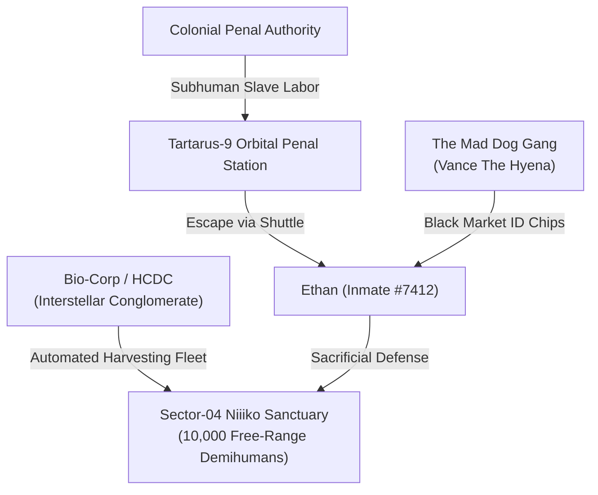
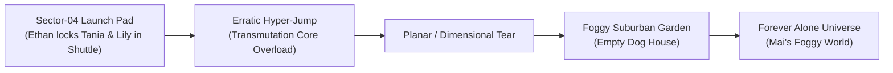

# Niiikotopia: Human — World Building & Lore Codex

> **Document Type:** World Bible, Faction Lore & Universe Connections  
> **Parent Document:** [Niiikotopia Human GDD.md](file:///Users/taniafelidae/ETStudio/ETWorldDesigner/GameDesigner/PC%20Game/Niiikotopia%20Human/Niiikotopia%20Human%20GDD.md)  
> **Related Documents:**  
> - [Niiikotopia Human Plot.md](file:///Users/taniafelidae/ETStudio/ETWorldDesigner/GameDesigner/PC%20Game/Niiikotopia%20Human/Niiikotopia%20Human%20Plot.md)  
> - [Niiikotopia Human Gameplay.md](file:///Users/taniafelidae/ETStudio/ETWorldDesigner/GameDesigner/PC%20Game/Niiikotopia%20Human/Niiikotopia%20Human%20Gameplay.md)  
> - [Niiikotopia Human Characters.md](file:///Users/taniafelidae/ETStudio/ETWorldDesigner/GameDesigner/PC%20Game/Niiikotopia%20Human/Niiikotopia%20Human%20Characters.md)  
> - Related Game: [Forever Alone.md](file:///Users/taniafelidae/ETStudio/ETWorldDesigner/GameDesigner/PC%20Game/Forever%20Alone.md)  
> - Reference: [Niiikotopia Human Raw Design.md](file:///Users/taniafelidae/ETStudio/ETWorldDesigner/GameDesigner/PC%20Game/Niiikotopia%20Human/Niiikotopia%20Human%20Raw%20Design.md)

---

## 1. World Overview: Sector-04 Sanctuary

### 1.1 The Genesis of the Sanctuary
Fifty-two Earth standard years before Ethan's crash, **Bio-Corp Interstellar** initiated *Project Felis*. By splicing docile feline genetic sequences into human zygotes, researchers engineered the **Niiikos** (classified in colonial records as *Hucats* / *Asset-Species F-09*).

The objective was industrial and biomedical:
1. **Bio-Active Organs:** Niiiko internal biology produces enzymes that arrest cellular aging in wealthy human colonial elites.
2. **Cosmetic Luxury Market:** Their soft ears and tails fetch millions of credits in the pleasure spires of the Core Worlds.

Following a severe corporate budget crisis and regulatory inspection threat, the researchers abandoned the research facility on Sector-04. They left the automated ecological controls running, letting the first generation of Niiikos roam free. Over five decades in isolation, the Niiikos built a peaceful pastoral civilization around the ruins of the laboratories, unaware that they were being allowed to multiply as free-range livestock until their population breached the commercial harvest threshold of 10,000 individuals.

---

## 2. Key Factions & Organizations

### 2.1 The Human Colony Defense Corporation (HCDC)
- **True Nature:** The private security and planetary reclamation arm of Bio-Corp.
- **Corporate Euphemism:** They brand mass livestock seizures as "Resource Reclamation & Asset Security."
- **Standard Operating Procedure:**
  - Deployment of non-lethal, electrical-shock drones to avoid bruising or damaging organ tissue.
  - Deploys quad-legged vacuum harvesters that crate unconscious specimens directly into cryogenic orbital pods.
  - Deploys automated Anti-Air (AA) batteries on mountain ridges to eliminate any unauthorized off-world flights.

### 2.2 Tartarus-9 & The Penal Reclamation Act
- **Legal Dehumanization:** Under 26th-century colonial maritime law, felons whose negligence or intent results in mass casualties have their citizen identity chips melted out of their wrists with an industrial plasma torch.
- **The Subhuman Registry:** Convicts are reassigned as numbered industrial equipment. They have no legal rights to speak, appeal, or hold property. Ethan lived under this psychological degradation for 7,300 days, creating his desperate yearning for a plastic citizen ID card.

### 2.3 The Mad Dog Gang
- **Background:** An interstellar syndicate operating out of abandoned asteroid mining belts. Specializes in forged biometric passports, hijacked fuel shipments, and smuggling exotic biological commodities into corporate core planets.
- **Leader:** Vance "The Hyena," Ethan's former handler before the fatal transport disaster.

---

## 3. Cultural Lore: The Plastic Name Tags

One of the most poignant world details is the **Plastic Name Tags**:

- **The Corporate Reality:** When the bio-scientists created the first generation, each infant Niiiko was clipped with a durable, non-biodegradable polymer barcode tag around their neck (e.g., `SPECIMEN-0012-NYA`, `ASSET-0418-TANIA`, `WILD-0801-LILY`).
- **The Niiiko Mythos:** Lacking knowledge of colonial science, the Niiikos grew to revere these tags as sacred gifts from the "Ancient Creators" (The Tall Ones). To a Niiiko, the tag is their true soul-name, proving that they are unique, loved, and part of the village family.
- **The Thematic Contrast:** Ethan is a legally registered human who was stripped of his name and reduced to a barcode number (`#7412`). The Niiikos were created as barcode numbers, yet elevated their tags into holy symbols of love and personhood.

---

## 4. The Cross-Game Dimensional Bridge into *Forever Alone*

### 4.1 The Iron Hound Shuttle & The Broken Manifold
During the climax in Act 7, Tania attempts to coordinate a hyperdrive coordinate jump with an improvised transmutation crystal. When Ethan forcefully shuts her and Lily into the cockpit and engages the automated emergency launch lever, the jump coordinates collapse under the planetary atmospheric distortion.

The shuttle does not jump to a standard colonial star system. Instead, the unstable dimensional tear punches clean through the dimensional barrier, hurling the *Iron Hound* into the surreal, foggy pocket-dimension of **[Forever Alone](file:///Users/taniafelidae/ETStudio/ETWorldDesigner/GameDesigner/PC%20Game/Forever%20Alone.md)**:

1. **The Crash Site:** The shuttle crashes into the soft earth of the garden behind Mai's house, right next to the empty wooden doghouse.
2. **The Missing Manifold Screws:** The impact shakes loose three vital titanium manifold screws, scattering them into the surrounding foggy neighborhood (The Lonely Park, The Nearby Market, and The School Courtyard).
3. **The Shared Journey:** Tania and Lily survive, emerging into the cold, silent fog of Mai's nightmare. Their search for spare parts to repair the shuttle intertwines with Mai's psychological quest to understand her family's disappearance, uniting the emotional arcs of both games under the ET Studio universe.
